# 🖼️ Computer Vision Track

> **Methodology: Inverted Engineering & Sabotage Lab**
> See it run → Dissect internals → Break it deliberately → Build it clean.

This track teaches Computer Vision from pixel tensors to production-ready inference pipelines. Each module follows the **4-phase Inverted Engineering** approach so you build deep, unshakeable intuition — not just pattern recognition.

---

## 🗺️ Curriculum Roadmap

```mermaid
flowchart TD
    A["🟢 START\nPixels & Tensors"] --> M01

    subgraph M01["Module 01 · Image Fundamentals"]
        direction TB
        m01a["📐 3D Tensor Layout C×H×W"]
        m01b["🎨 RGB Channels & Pixel Ranges"]
        m01c["⚖️ Normalization (why it's non-negotiable)"]
        m01d["🔄 Data Augmentation Philosophy"]
        m01a --> m01b --> m01c --> m01d
    end

    M01 --> M02

    subgraph M02["Module 02 · Classical CV & Feature Extraction"]
        direction TB
        m02a["📊 HOG & SIFT/SURF"]
        m02b["🔲 Sobel/Canny Edge Detection"]
        m02c["🧮 Manual Conv2d Kernels"]
        m02d["💥 Why Classical CV Failed → DL Revolution"]
        m02a --> m02b --> m02c --> m02d
    end

    M02 --> M03

    subgraph M03["Module 03 · CNN Architecture Deep Dive"]
        direction TB
        m03a["🏗️ Conv Layer Anatomy\n(kernel, stride, padding, dilation)"]
        m03b["📐 BatchNorm & Pooling"]
        m03c["🔁 ResNet Skip Connections"]
        m03d["⚡ MobileNet Depthwise Sep Conv"]
        m03a --> m03b --> m03c --> m03d
    end

    M03 --> M04

    subgraph M04["Module 04 · Transfer Learning & Fine-Tuning"]
        direction TB
        m04a["❄️ Feature Extractor (frozen)"]
        m04b["🌡️ Last-N Layer Fine-Tuning"]
        m04c["🔥 Full Fine-Tuning"]
        m04d["📉 Discriminative Learning Rates"]
        m04e["🚀 Progressive Layer Unfreezing"]
        m04a --> m04b --> m04c --> m04d --> m04e
    end

    M04 --> M05

    subgraph M05["Module 05 · Segmentation & Localization"]
        direction TB
        m05a["🟦 Classification vs Detection\nvs Segmentation Taxonomy"]
        m05b["🏛️ FCN & U-Net Architecture"]
        m05c["🎯 Dice Loss vs BCE Loss"]
        m05d["🗺️ Encoder-Decoder Skip Connections"]
        m05a --> m05b --> m05c --> m05d
    end

    M05 --> M06

    subgraph M06["Module 06 · Production CV System"]
        direction TB
        m06a["📦 Dataset Pipeline & Augmentation"]
        m06b["⚡ Mixed Precision Training"]
        m06c["📤 TorchScript Export"]
        m06d["🎬 Visual Inference Demo"]
        m06a --> m06b --> m06c --> m06d
    end

    M06 --> Z["🏆 Production-Ready CV Engineer"]

    style A fill:#22c55e,color:#fff
    style Z fill:#f59e0b,color:#fff
    style M01 fill:#dbeafe,stroke:#3b82f6
    style M02 fill:#fef3c7,stroke:#f59e0b
    style M03 fill:#fce7f3,stroke:#ec4899
    style M04 fill:#f0fdf4,stroke:#22c55e
    style M05 fill:#fdf4ff,stroke:#a855f7
    style M06 fill:#fff1f2,stroke:#f43f5e
```



---

## 📚 Module Overview

| # | Module | Core Concepts | Sabotage Experiment | Notebook Challenge |
|---|--------|---------------|--------------------|--------------------|
| 01 | [Image Fundamentals](modules/01_image_fundamentals/README.md) | Tensors, RGB, Normalization, Augmentation | No-normalization inference → wrong predictions | Load, inspect, transform images |
| 02 | [Classical CV](modules/02_classical_cv/README.md) | HOG, Sobel/Canny, Color Histograms | Canny on textures without blur → chaos | Manual Conv2d Sobel kernel |
| 03 | [CNN Architectures](modules/03_cnn_architectures/README.md) | Conv, BN, Pooling, ResNet, MobileNet | ResNet without skip connections → degradation | Build mini-ResNet from scratch |
| 04 | [Transfer Learning](modules/04_advanced_transfer_learning/README.md) | Pre-train, Fine-tune, Discriminative LR | Same LR all layers → catastrophic forgetting | >75% val acc with 500 samples |
| 05 | [Segmentation](modules/05_segmentation/README.md) | FCN, U-Net, Dice Loss, Instance vs Semantic | CE loss on imbalanced seg → thin structure loss | Mini U-Net on synthetic shapes |
| 06 | [Real Project](modules/06_real_project/README.md) | Full pipeline, Albumentations, TorchScript | — (build it production-clean) | Complete classifier system |

---

## 🧰 Learning Methodology: Inverted Engineering & Sabotage Lab

Each module follows this 4-phase structure:

```
Phase 1 ── THE WORKING BLACKBOX ───────────────────────────────────
           Run the full system in < 5 minutes. See it work.
           No explanations yet. Just observe outputs.

Phase 2 ── ANATOMICAL DISSECTION ──────────────────────────────────
           Crack open the black box. Inspect feature maps,
           kernel weights, intermediate tensors. Ask "why?"

Phase 3 ── THE SABOTAGE LAB ────────────────────────────────────────
           Break something deliberately. Remove normalization.
           Wrong loss. No skip connections. Watch it fail.
           Fix it. Understand WHY it failed.

Phase 4 ── CLEAN BUILD + FEYNMAN TEST ──────────────────────────────
           Write production-clean code. Answer Feynman
           Checkpoint questions in plain English.
           If you can't explain it simply, you don't know it.
```

---

## 🛠️ Environment

- **Python venv**: `/Users/kharisaz/Playground/Data AI/.venv`
- **Jupyter Kernel**: `Python (Data AI .venv)`
- **Key Libraries**: PyTorch 2.x, torchvision 0.x, transformers, sklearn, numpy, matplotlib, PIL

### Quick Kernel Check
```python
import torch, torchvision, PIL
print(f"PyTorch: {torch.__version__}")
print(f"torchvision: {torchvision.__version__}")
print(f"CUDA: {torch.cuda.is_available()} | MPS: {torch.backends.mps.is_available()}")
```

---

## 📁 Directory Structure

```
computer-vision/
├── README.md                          ← You are here
├── shared/
│   └── cv_utils.py                    ← Shared visualization utilities
└── modules/
    ├── 01_image_fundamentals/
    │   ├── README.md
    │   └── 01_image_fundamentals.ipynb
    ├── 02_classical_cv/
    │   ├── README.md
    │   └── 02_classical_cv.ipynb
    ├── 03_cnn_architectures/
    │   ├── README.md
    │   └── 03_cnn_architectures.ipynb
    ├── 04_advanced_transfer_learning/
    │   ├── README.md
    │   └── 04_advanced_transfer_learning.ipynb
    ├── 05_segmentation/
    │   ├── README.md
    │   └── 05_segmentation.ipynb
    └── 06_real_project/
        ├── README.md
        └── 06_real_project.ipynb
```

---

## 🚦 How to Start

1. Open Jupyter Lab: `jupyter lab` (with the Data AI venv active)
2. Select kernel: **Python (Data AI .venv)**  
3. Start with **Module 01** — run all cells in the blackbox section first
4. After each module, answer the **3 Feynman Checkpoint questions** in your own words

> **Rule**: Do not proceed to the next module until you can answer all 3 Feynman questions without looking at notes.
