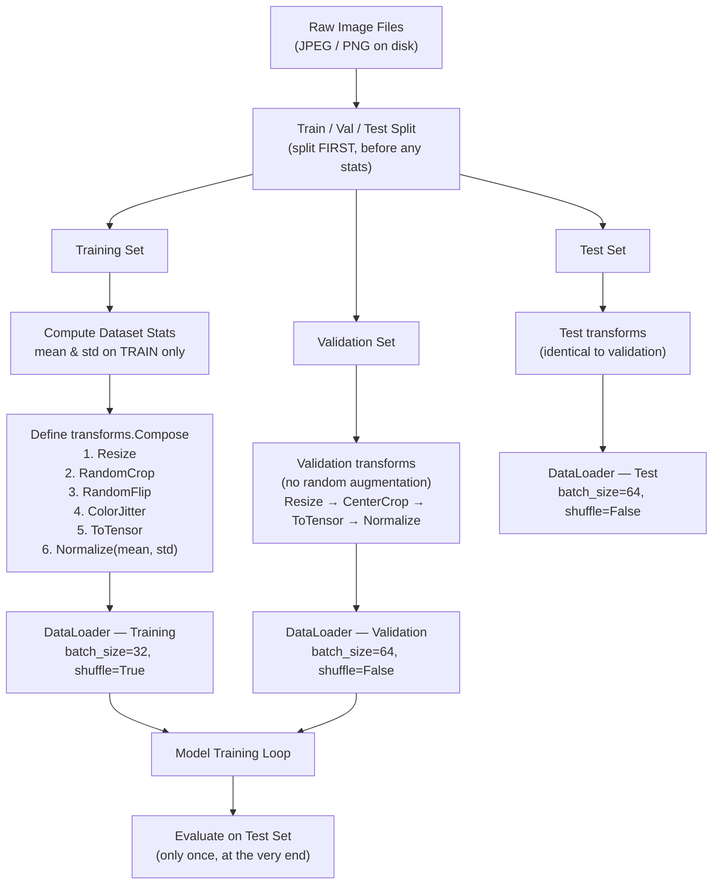

# Module 01 — Image Fundamentals

> **Track:** Computer Vision Lab  
> **Level:** Foundational  
> **Estimated time:** 2–3 hours  

---

## Learning Objectives

By the end of this module you will be able to:

1. Explain how a digital image is stored as a 3-D numeric tensor.
2. Describe the RGB color model and the two common pixel-value conventions (integer vs. float).
3. Justify *mathematically* why pretrained models **require** proper normalization.
4. Distinguish **invariance** from **equivariance** in the context of data augmentation.
5. Enumerate the properties of a high-quality training dataset.

---

## 1 — Images as 3-D Tensors

A colour image is nothing more than a rectangular grid of *pixels*, where each pixel stores three numbers — one for each colour channel (Red, Green, Blue). PyTorch stores images in the layout **[C, H, W]**: Channels first, then Height, then Width.

```
Image tensor shape: [C=3, H=4, W=5]   (tiny example — 4 rows × 5 cols)

Channel 0 — RED
  ┌─────────────────────────┐
  │ R00  R01  R02  R03  R04 │  ← row 0
  │ R10  R11  R12  R13  R14 │  ← row 1
  │ R20  R21  R22  R23  R24 │  ← row 2
  │ R30  R31  R32  R33  R34 │  ← row 3
  └─────────────────────────┘

Channel 1 — GREEN
  ┌─────────────────────────┐
  │ G00  G01  G02  G03  G04 │
  │ G10  G11  G12  G13  G14 │
  │ G20  G21  G22  G23  G24 │
  │ G30  G31  G32  G33  G34 │
  └─────────────────────────┘

Channel 2 — BLUE
  ┌─────────────────────────┐
  │ B00  B01  B02  B03  B04 │
  │ B10  B11  B12  B13  B14 │
  │ B20  B21  B22  B23  B24 │
  │ B30  B31  B32  B33  B34 │
  └─────────────────────────┘

Full tensor memory layout (C-major, then row-major):
  [R00,R01,...,R34, G00,...,G34, B00,...,B34]
   \___ 20 values__/ \___ 20 ___/ \___ 20 __/
         C×H×W = 3×4×5 = 60 total scalar values
```

> **Note — PIL vs PyTorch layout:**  
> PIL (and most image-file formats) store pixels as **[H, W, C]** (channels last).  
> NumPy arrays from PIL are also **[H, W, C]**.  
> `torchvision.transforms.ToTensor()` automatically transposes to **[C, H, W]** *and* scales `uint8 [0,255]` → `float32 [0.0, 1.0]`.

---

## 2 — The RGB Color Model

| Channel | Represents | Low value | High value |
|---------|-----------|-----------|------------|
| **R** — Red   | Amount of red light   | No red (dark/cyan) | Full red |
| **G** — Green | Amount of green light | No green (dark/magenta) | Full green |
| **B** — Blue  | Amount of blue light  | No blue (dark/yellow) | Full blue |

RGB is an **additive** model: combining full R + full G + full B produces white (255, 255, 255). Absence of all three produces black (0, 0, 0).

### Pixel value conventions

| Convention | Dtype | Range | Typical use |
|------------|-------|-------|-------------|
| **Integer** | `uint8` | `[0, 255]` | Image files on disk, PIL, OpenCV |
| **Float (normalised to [0,1])** | `float32` | `[0.0, 1.0]` | After `ToTensor()`, initial model input |
| **Float (ImageNet-normalised)** | `float32` | ≈ `[-2.1, 2.6]` | After `transforms.Normalize(...)` |

The simple division `pixel / 255.0` maps the integer range linearly to `[0.0, 1.0]`.  
This is **not** the same as *ImageNet normalisation* — see Section 3.

---

## 3 — Why Normalisation Is Critical (The Math)

### 3.1 What pretrained models were trained on

ResNet, VGG, EfficientNet, ViT… all the major ImageNet-pretrained models were trained on pixels that were:

1. Divided by 255 → range `[0, 1]`
2. Standardised channel-by-channel using the ImageNet dataset statistics:

```
μ = [0.485, 0.456, 0.406]   # mean  per channel  (R, G, B)
σ = [0.229, 0.224, 0.225]   # stdev per channel  (R, G, B)

normalised_pixel = (pixel/255 - μ) / σ
```

This produces a distribution with **zero mean and unit variance** — the same distribution the model's weights were optimised against.

### 3.2 What happens if you skip normalisation

Suppose a pixel has value `200` in the Red channel.

| Step | Value | Formula |
|------|-------|---------|
| Raw integer | `200` | as-is |
| ÷ 255 | `0.784` | correctly scaled |
| Properly normalised | `(0.784 − 0.485) / 0.229 ≈ +1.31` | what the model expects |

Now imagine you feed the **raw** `200` directly (skipping both steps):

```
What the model receives  : 200
What the model expects   : ≈ +1.31

Ratio                    : 200 / 1.31 ≈ 153×  ← the activation is ~153× too large
```

For the **green channel** (mean=0.456, std=0.224):

```
Normalised expectation of a "128" green pixel:
  (128/255 − 0.456) / 0.224 = (0.502 − 0.456) / 0.224 ≈ +0.205

Raw value fed: 128

Ratio: 128 / 0.205 ≈ 624×
```

So raw pixel values are roughly **100–600× out-of-distribution** compared to what the first linear layer was calibrated for.  
Every batch-norm layer, every weight, every bias was fit to the normalised distribution.  
Feeding raw integers floods the network with wildly out-of-range activations — the model outputs garbage.

### 3.3 Only `÷ 255` is not enough either

Even if you correctly scale to `[0, 1]`, you are still off by the mean shift:

```
Un-shifted pixel (÷255 only): 0.784
Properly normalised:          (0.784 − 0.485) / 0.229 ≈ +1.31

Error: (0.784 − 1.31) = −0.526  ← constant bias in every activation
```

The mean subtraction removes the DC bias, and the standard-deviation division ensures the spread of values matches what the model expects.  
**Both steps are required.**

---

## 4 — Data Augmentation: Invariance vs. Equivariance

Data augmentation artificially expands your dataset by applying transforms to existing samples.  
The design principle that governs which transforms are *legal* comes in two flavours:

### 4.1 Invariance — label does not change

> A transform is **label-invariant** for a task if applying it does not change the correct answer.

**Example — image classification:**

```
Original image  → [cat]          label: "cat"
H-flipped image → [cat mirrored] label: "cat"   ✔  (still a cat)
```

`RandomHorizontalFlip`, `RandomCrop`, `ColorJitter`, `GaussianBlur` are all **valid** augmentations for classification because the class identity is preserved under these transforms.

### 4.2 Equivariance — output shifts *with* the input

> A transform is **equivariant** for a task if the output label should *also* be transformed in the same way.

**Example — object detection / bounding boxes:**

```
Original image → bounding box at [x=50, y=30, w=80, h=60]
H-flipped image → bounding box must also be flipped:  [x = W−50−80, y=30, ...]
```

The label is not the same, but it transforms *predictably* alongside the image.
You must apply the **same geometric transform** to both the image and its label.

### 4.3 When invariance breaks — the licence-plate example

```
Original plate : "ABC 123"  →  label: "ABC 123"
H-flipped plate: "321 CBA"  →  label: "321 CBA"   ✘  completely different string!
```

`RandomHorizontalFlip` is **not** label-invariant for OCR tasks.  
Applying it naively would corrupt the training signal.

```
Summary table:

 Transform          | Image classification | Object detection | OCR / text
 ─────────────────────────────────────────────────────────────────────────
 RandomHorizontalFlip | ✔ invariant         | ✔ equivariant    | ✘ INVALID
 RandomCrop           | ✔ invariant         | ✔ equivariant    | ✔ (if text stays)
 ColorJitter          | ✔ invariant         | ✔ invariant      | ✔ invariant
 RandomRotation       | ✔ (small angles)    | ✔ equivariant    | ✘ (large angles)
```

**Key principle:** Always ask *"If I apply this transform, does the label still make sense, and how must it change?"* before adding any augmentation.

---

## 5 — What Makes a Good Training Dataset

### 5.1 Class balance

If 90% of your images are "cat" and 10% are "dog", the model learns to always predict "cat" and achieves 90% accuracy while being completely useless. Solutions: over-sample the minority class, under-sample the majority, or use weighted loss.

### 5.2 Diversity

The model generalises only to variation it has *seen* during training. A dog-classifier trained only on studio photos of golden retrievers will fail on low-light photos of black dogs. Diversity means:

- Multiple lighting conditions, backgrounds, viewpoints
- Different image resolutions and compression artefacts
- Demographic diversity (for tasks involving people)
- Edge cases and hard negatives

### 5.3 No data leakage

Data leakage occurs when information from the **test set** contaminates the **training set**, producing artificially inflated metrics.

**Common leakage patterns:**

| Pattern | Description |
|---------|-------------|
| Temporal leakage | Future data used to predict the past |
| Augmentation leakage | Augmenting *then* splitting (same base image in train and test) |
| Preprocessing leakage | Computing normalisation statistics on the entire dataset before splitting |
| Duplicate leakage | Near-duplicate images in both train and test splits |

**Rule:** always split *first*, compute statistics (mean, std, etc.) on the *training set only*, then apply those statistics to val/test.

```
Pipeline flowchart — see below
```

---

## 6 — End-to-End Pipeline (Mermaid)



---

## 7 — ASCII Diagram: Normalisation Effect on Pixel Distribution

```
Before normalisation (ToTensor only — range [0, 1]):

  Frequency
  │
  │    ██████████
  │   ████████████
  │  ██████████████
  │ ████████████████
  │████████████████████
  └─────────────────────────── pixel value
  0.0                       1.0
  Mean ≈ 0.45   Std ≈ 0.25


After ImageNet normalisation (mean subtracted, ÷ std):

  Frequency
  │
  │         ██████
  │        █████████
  │       ████████████
  │      ██████████████
  │     ████████████████
  └─────────────────────────── pixel value
  -2.1    0.0            +2.6
  Mean ≈  0.0   Std ≈ 1.0
```

The distribution is now centred at zero with unit variance — exactly what the model's weights expect.

---

## 8 — Feynman Checkpoint Questions

> Think carefully before reading the hint. Try to explain it as if teaching someone else — if you can't, you don't yet understand it fully.

---

### ❓ Question 1

> **"Explain to a child: why can't we feed a raw 0–255 pixel image to a pretrained neural network? What goes wrong and why?"**

<details>
<summary>Hint (click to expand)</summary>

Think about how the network's weights were tuned. Every multiplication, every addition, every batch-norm layer was calibrated expecting numbers in a specific small range. What happens to those intermediate values when you feed in numbers that are 100× larger?

</details>

---

### ❓ Question 2

> **"You have a cat image. When you apply `RandomHorizontalFlip` as augmentation, the label stays 'cat'. But if you applied it to a licence-plate OCR model, would that be correct? Why or why not? What principle does this illustrate?"**

<details>
<summary>Hint (click to expand)</summary>

A mirrored cat is still a cat. Is a mirrored licence plate still the same licence plate number? What is the general rule for deciding whether an augmentation is valid for a given task?

</details>

---

### ❓ Question 3

> **"A friend says 'I'll just divide all pixel values by 255 to normalise.' Is this correct? What's missing, and how does proper ImageNet normalisation differ?"**

<details>
<summary>Hint (click to expand)</summary>

Dividing by 255 puts you in `[0, 1]`. ImageNet normalisation does two additional things. Write out the full formula and explain why each step matters mathematically.

</details>

---

## References

- He et al., *Deep Residual Learning for Image Recognition* (2015)
- ImageNet Large Scale Visual Recognition Challenge (ILSVRC) statistics
- PyTorch `torchvision.transforms` documentation
- Shorten & Khoshgoftaar, *A Survey on Image Data Augmentation for Deep Learning*, Journal of Big Data (2019)
