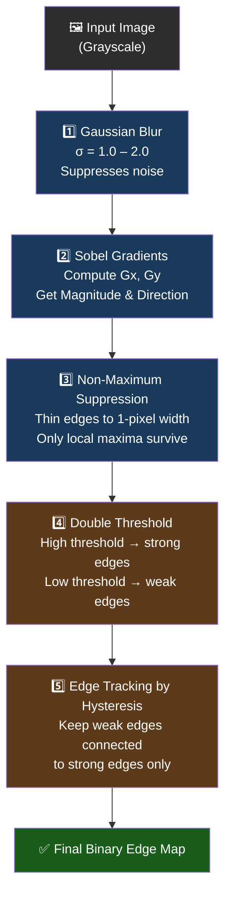

# Module 02 — Classical Computer Vision (Pre-Deep-Learning Era)

> **Track:** Computer Vision Lab  
> **Prerequisites:** Module 01 — Image Fundamentals  
> **Next:** Module 03 — CNN Architectures

---

## Learning Objectives

By the end of this module you will be able to:

1. Explain the dominant paradigm of computer vision from **2000–2012** and why it eventually broke down.
2. Implement and interpret **HOG**, **Sobel**, and **Canny** from first principles.
3. Understand **SIFT/SURF** conceptually and articulate why scale & rotation invariance matter.
4. Describe **color histograms** and their blind spots.
5. Apply **morphological operations** and explain what each one does geometrically.
6. Articulate the **ImageNet 2012** moment and why it changed everything.

---

## 1. The Pre-Deep-Learning Era (2000–2012)

### 1.1 The Dominant Paradigm

Before deep learning exploded the field, computer vision followed a rigid two-stage recipe:

```
Raw Image  →  [Hand-crafted Feature Extractor]  →  [Classical Classifier]  →  Label
                     (HOG, SIFT, Haar, …)           (SVM, Random Forest)
```

Researchers spent *years* designing feature extractors — algorithms that converted a raw pixel grid into a compact, meaningful descriptor that a downstream classifier (usually an SVM) could consume.

The philosophy was: **if you can describe the image well enough, classification becomes easy**.

This worked surprisingly well for constrained problems:

| Task | Winning Feature | Classifier |
|------|----------------|------------|
| Pedestrian detection | HOG | Linear SVM |
| Face detection | Haar cascades | AdaBoost |
| Image matching | SIFT | Nearest-neighbor |
| Scene recognition | GIST, color histograms | SVM |

### 1.2 The Timeline

| Year | Milestone |
|------|-----------|
| 2001 | Viola-Jones face detector (Haar + AdaBoost, real-time) |
| 2004 | SIFT (Lowe) — robust keypoint matching |
| 2005 | HOG (Dalal & Triggs) — pedestrian detection benchmark |
| 2006 | SURF — faster approximation to SIFT |
| 2009 | ImageNet dataset released (14M images, 1000 classes) |
| 2010 | ILSVRC competition begins; classical methods dominate |
| 2012 | **AlexNet** wins ILSVRC with 15.3% top-5 error (vs 26.2% runner-up) |

---

## 2. HOG — Histogram of Oriented Gradients

HOG was introduced by Dalal & Triggs (CVPR 2005) specifically for **pedestrian detection** and remained the state-of-the-art for years.

### 2.1 The Core Intuition

A human silhouette has characteristic edge patterns: vertical lines for legs, diagonal for arms, curved for the head. HOG encodes **where** gradients point and **how strong** they are, independent of exact pixel values.

> *Edges don't care about absolute brightness — only about local contrast directions.*

### 2.2 Step-by-Step Pipeline

#### Step 1: Compute Gradients
Apply finite-difference filters in X and Y:

```
Gx = I(x+1, y) − I(x−1, y)
Gy = I(x, y+1) − I(x, y−1)

Magnitude:  M(x,y) = sqrt(Gx² + Gy²)
Direction:  θ(x,y) = arctan(Gy / Gx)   ← in [0°, 180°) unsigned
```

#### Step 2: Divide into Cells
Split the image into small cells (typically **8×8 pixels**).

#### Step 3: Build Orientation Histogram per Cell
For each cell, bin the gradient magnitudes into **9 orientation bins** spanning 0°–180°:

```
Bin:   0°   20°   40°   60°   80°  100°  120°  140°  160°
       ┌────┬────┬────┬────┬────┬────┬────┬────┬────┐
Cell:  │    │    │ ██ │ ██ │    │    │    │    │    │
       └────┴────┴────┴────┴────┴────┴────┴────┴────┘
              Gradient votes weighted by magnitude
```

A pixel with M=50 and θ=45° votes into the 40° bin with weight 50.

#### Step 4: Group Cells into Blocks
Collect 2×2 cells into a **block**. Concatenate their 9-bin histograms → 36-dim vector per block.

#### Step 5: L2-Normalize Each Block
```
v_normalized = v / sqrt(||v||² + ε²)
```
This makes the descriptor **invariant to local illumination changes**.

#### Step 6: Concatenate Block Descriptors
Slide the block over all positions → concatenate all normalized block descriptors → final HOG feature vector.

```
ASCII: HOG Feature Construction

Image (64×128)
  ┌──────────────────────────┐
  │  Cell  Cell  Cell  Cell  │  Each cell = 8×8 pixels
  │  [9]   [9]   [9]   [9]  │  = 9-bin histogram
  │                          │
  │  Block = 2×2 cells       │
  │  = 4 × 9 = 36 values     │
  │                          │
  │  Blocks overlap → dense  │
  └──────────────────────────┘
  Final descriptor: ~3780 dims for 64×128 window
```

### 2.3 Why HOG Works for Pedestrians

- **Gradient orientation** captures shape outlines regardless of color or lighting.
- **Block normalization** handles shadows and partial illumination changes.
- **Local histograms** tolerate small positional jitter of body parts.
- **Unsigned orientation (0–180°)** treats a left-facing edge the same as a right-facing edge — good for symmetric objects like legs.

### 2.4 HOG Limitations

- Fragile to occlusion and viewpoint change.
- Assumes upright, roughly uniform-size objects.
- Slow to compute for many candidate windows.

---

## 3. SIFT & SURF — Scale-Invariant Feature Transforms

### 3.1 The Problem They Solve

When two photos of the same scene are taken from different distances or angles, pixels at corresponding locations have completely different values. We need **features that match across these transformations**.

### 3.2 SIFT (Scale-Invariant Feature Transform — Lowe 2004)

#### Keypoint Detection
1. Build a **Gaussian scale space**: blur the image progressively with σ = 1, √2, 2, 2√2, ...
2. Compute **Difference of Gaussians (DoG)** = adjacent blurred images subtracted.
3. Find **local extrema** in DoG across space AND scale → these are stable keypoints.

#### Orientation Assignment
- At each keypoint, compute gradient orientations in a local neighborhood.
- Assign the **dominant orientation** as the keypoint's reference orientation.
- This makes the descriptor **rotation-invariant**: rotate everything relative to the dominant direction.

#### Descriptor Construction
- Divide a 16×16 neighborhood into a 4×4 grid of cells.
- Compute 8-bin orientation histograms per cell.
- Concatenate → **128-dimensional descriptor**.

#### Invariances
| Invariance | How Achieved |
|------------|--------------|
| Scale | Multi-scale DoG detection |
| Rotation | Dominant orientation normalization |
| Illumination | Gradient-based (ignores absolute brightness) |
| Translation | Detector finds same point regardless of position |

### 3.3 SURF (Speeded-Up Robust Features — Bay 2006)

SURF approximates SIFT using **box filters** (cheap with integral images) instead of Gaussian blurs. About **3-7× faster** than SIFT, similar matching quality.

---

## 4. Color Histograms

### 4.1 What They Capture

A **color histogram** bins pixel values by color (hue, RGB channel, or HSV) and counts occurrences:

```python
# Per-channel histogram
R_hist, _ = np.histogram(image[:,:,0], bins=256, range=(0,255))
G_hist, _ = np.histogram(image[:,:,1], bins=256, range=(0,255))
B_hist, _ = np.histogram(image[:,:,2], bins=256, range=(0,255))
```

**What they capture:**
- Overall color distribution of the scene.
- Dominant hues, average saturation.
- Whether the image is warm or cool.

### 4.2 What They Miss

| Missing Information | Example |
|--------------------|---------|
| **Spatial layout** | A red car and a red sunset look the same |
| **Texture** | Smooth wood vs rough bark with same average color |
| **Shape** | A circle and a rectangle of same color are indistinguishable |
| **Object boundaries** | No notion of where one region ends and another begins |

> Color histograms are a **bag-of-colors** model: shuffling every pixel randomly doesn't change the histogram at all.

---

## 5. Sobel Operator — Edge Detection via Gradient

### 5.1 The Two Kernels

The Sobel operator uses two **3×3 convolution kernels** to approximate image derivatives:

| Kernel | Name | Detects |
|--------|------|---------|
| **Gx** | Horizontal gradient | Vertical edges |
| **Gy** | Vertical gradient | Horizontal edges |

**Gx kernel** (∂I/∂x):

| | col-1 | col | col+1 |
|--|-------|-----|-------|
| **row-1** | -1 | 0 | +1 |
| **row** | -2 | 0 | +2 |
| **row+1** | -1 | 0 | +1 |

**Gy kernel** (∂I/∂y):

| | col-1 | col | col+1 |
|--|-------|-----|-------|
| **row-1** | +1 | +2 | +1 |
| **row** |  0 |  0 |  0 |
| **row+1** | -1 | -2 | -1 |

### 5.2 Computing Gradient Magnitude and Direction

```
Gradient Magnitude:  G = sqrt(Gx² + Gy²)
Gradient Direction:  θ = arctan2(Gy, Gx)
```

**Why the weights of -2 and +2 at the center?**  
The center row/column is weighted more because the central pixel is the one being analyzed — the neighbors contribute their derivative estimate, and the central row/column gives a smoother, less noise-sensitive estimate.

### 5.3 Reading the Response

```
Original Image Region:        Gx Response:       Gy Response:
   ···255 255 255···            near zero          large positive
   ···255 255 255···            near zero          large positive
   ···  0   0   0···            near zero          large positive
   ···  0   0   0···            near zero          near zero

(Horizontal dark/light boundary → Gy fires, Gx stays quiet)
```

---

## 6. Canny Edge Detection — The Gold Standard

Canny (1986) remains one of the most used edge detectors. It's optimal in the sense of minimizing false edges while maximizing detection and localization.

### 6.1 The 5-Step Pipeline



### 6.2 Step-by-Step Explanation

#### Step 1: Gaussian Blur
Convolve with a Gaussian kernel (σ typically 1.0–2.0). This **attenuates high-frequency noise** before derivative computation. Noise creates false gradients; blur smooths them away.

```
Without blur: every tiny texture variation creates a "gradient spike" → edge chaos
With blur:    only real structural boundaries produce strong gradients
```

#### Step 2: Sobel Gradient Computation
Compute Gx, Gy (as described in Section 5). Compute magnitude G and direction θ at every pixel.

#### Step 3: Non-Maximum Suppression (NMS)
For each pixel, check if it is a **local maximum along the gradient direction**:
```
If G(x,y) < G(neighbor in gradient direction):
    suppress → set to 0
```
This thins fat edges into **1-pixel-wide curves**, dramatically improving localization.

#### Step 4: Double Threshold
Two thresholds define three classes:

```
G > T_high  →  Strong edge  ✅ (definitely edge)
T_low < G < T_high  →  Weak edge  ❓ (maybe edge)
G < T_low  →  Not edge  ❌
```

Typical ratio: T_high / T_low ≈ 2:1 to 3:1.

#### Step 5: Edge Tracking by Hysteresis
- Start from **strong edge pixels**.
- Include any **weak edge pixel** that is **8-connected** to a strong pixel.
- Discard isolated weak pixels.

This cleverly retains true edges (which tend to connect to strong responses) and drops noise (which tends to be isolated).

```
ASCII: Hysteresis in action

  Before hysteresis:          After hysteresis:
  S = Strong, W = Weak        Connected weak → kept (K)
                              Isolated weak → dropped (·)

  · · S S S W W ·             · · S S S K K ·
  · · S W · · W ·    →        · · S K · · · ·
  · · S · · · · ·             · · S · · · · ·
  (W connected to S = kept)   (isolated W = dropped)
```

### 6.3 Why Gaussian Blur Must Come First

Without blur, every natural texture (grass, fabric, skin pores) produces strong local gradients. The Sobel step fires everywhere. NMS can't save you — there are too many true local maxima.

With blur, small-scale textures are averaged out. Only large-scale boundaries (object contours, shadows, specular highlights) survive with strong gradient magnitude.

---

## 7. Morphological Operations

Morphological operations act on **binary images** (or grayscale) using a **structuring element** (SE) — a small kernel that probes the neighborhood.

### 7.1 Erosion

```
Output pixel = 1   iff   ALL pixels under SE in input = 1
```

**Effect:** Shrinks white regions. Removes small white noise specks. Separates touching objects.

```
Input:        SE (3×3 cross):     Output (Erosion):
■ ■ ■ ■        · ■ ·               · ■ · ·
■ ■ ■ ■        ■ ■ ■       →       · ■ · ·
■ ■ · ·        · ■ ·               · · · ·
· · · ·                            · · · ·
```

### 7.2 Dilation

```
Output pixel = 1   iff   ANY pixel under SE in input = 1
```

**Effect:** Grows white regions. Fills small holes. Bridges narrow gaps.

### 7.3 Opening (Erosion → Dilation)

Erosion followed by dilation with the same SE:

```
Opening = Dilate(Erode(Image, SE), SE)
```

- **Removes** small bright noise specks (eroded away, too small to dilate back).
- **Preserves** the overall shape of larger objects.

### 7.4 Closing (Dilation → Erosion)

```
Closing = Erode(Dilate(Image, SE), SE)
```

- **Fills** small dark holes and narrow dark gaps.
- **Preserves** the overall shape.

| Operation | Sequence | Use Case |
|-----------|----------|----------|
| Erosion | — | Remove small speckle noise |
| Dilation | — | Fill holes, bridge gaps |
| Opening | E → D | Remove bright noise blobs |
| Closing | D → E | Fill dark holes in bright regions |

---

## 8. Why Classical CV Failed — The Feature Engineering Treadmill

### 8.1 The Fundamental Problem

Every classical pipeline had the same hidden assumption: **a human expert can define what "looks like" a dog**.

This is fine for simple, constrained tasks. It catastrophically fails when:

- Objects appear at arbitrary viewpoints, scales, occlusions.
- The visual class is defined by semantics, not local appearance (e.g., "dangerous situation").
- You need to handle millions of fine-grained categories.

### 8.2 The Treadmill Analogy

```
Year 1: Engineer builds HOG + SVM → 70% accuracy on dogs vs cats
Year 2: Adds color histograms → 75%
Year 3: Adds SIFT, extra SVM stages, data augmentation → 82%
Year 4: ResNet appears → 98% in 1 week of training
```

Each marginal improvement required months of domain expertise. The features were **handcrafted** — they encoded the engineer's theory of what matters, not what actually matters statistically.

**Deep learning inverted the paradigm:** instead of humans deciding features, the network *learns* what features to build from data, guided only by the training objective.

### 8.3 The ImageNet 2012 Watershed

The **ILSVRC 2012 challenge** (1.2M images, 1000 classes) saw:

- **Runner-up** (classical CV ensemble): **26.2%** top-5 error
- **AlexNet** (CNN, Krizhevsky et al.): **15.3%** top-5 error — a **10.9 percentage point gap**

This wasn't a small improvement — it obliterated the field. AlexNet did not need hand-crafted features. It learned convolutional filters, learned multi-level representations, learned to distinguish 1000 classes end-to-end.

The classical CV era was over.

### 8.4 What Classical Techniques Are Still Used

Classical CV didn't disappear — it became a component:

- **Preprocessing:** Gaussian blur, morphological cleanup.
- **Traditional pipelines:** Medical imaging, industrial inspection (controlled conditions).
- **As explainability:** Edge maps help interpret CNN attention.
- **Inside deep networks:** Sobel-like operations appear in early CNN layers.
- **Low-data regimes:** When you have 50 samples and can't train a CNN.

---

## 9. Feynman Checkpoint Questions

Work through these questions before proceeding to the notebook. These are designed to surface conceptual misunderstandings.

---

### ❓ Feynman Check 1

> **Explain HOG features to a child. Why does binning gradient orientations help detect a pedestrian even if the lighting changes slightly?**

**Think about it:** A gradient is computed as a *difference* between adjacent pixels — so if you uniformly brighten the image (add 30 to every pixel), every difference stays the same. The gradient orientation captures *which direction* the image is getting brighter, not how bright it is in absolute terms. 

Imagine you're drawing a stick figure. Whether you draw it in a dimly lit room or a bright one, the *direction* of the lines stays the same. Binning orientations into coarse buckets (like "mostly vertical" or "mostly at 45°") adds another layer of robustness — a gradient at 43° and one at 47° both fall in the same bin, so small noise doesn't change the descriptor.

For a child: *"We're drawing a map of which direction things get lighter. Whether you use a bright crayon or a dark crayon, the arrows point the same way."*

---

### ❓ Feynman Check 2

> **Why does Canny edge detection apply Gaussian blur BEFORE computing gradients? What happens if you skip the blur step on a natural image with textures?**

**Think about it:** The Sobel operator is a derivative estimator. Derivatives amplify noise — if pixel values wiggle randomly due to sensor noise or fine texture (grass blades, woven fabric), the gradient magnitude will be large everywhere. 

Natural images have a **1/f² power spectrum**: most energy is in low spatial frequencies (smooth gradients, large structures), but there's still substantial high-frequency content. Differentiating without pre-smoothing means you're computing the derivative of noise as much as the derivative of structure.

With Gaussian blur, you're effectively asking: *"what is the gradient of the image if I only cared about features larger than σ pixels?"* — discarding the fine-grained texture before asking "where are the edges?"

Skip it on a photo of grass, and Canny will mark every blade tip as an "edge." The output is indistinguishable from salt-and-pepper noise.

---

### ❓ Feynman Check 3

> **A classical CV engineer spent 3 years building a feature extractor for dogs vs cats. Then ResNet came out and beat it in a week. What fundamental limitation of the manual feature approach did deep learning solve?**

**Think about it:** The classical engineer solved the problem they *thought* was important — encoding their domain knowledge about what dogs and cats look like. But their features encoded **their intuition**, which may not match what the data actually requires for optimal discrimination.

Deep learning solved the **representation learning** problem: *features don't need to be designed — they can be discovered automatically* from the training signal. 

More precisely:
1. **Hierarchical composition:** Deep networks learn simple → complex features automatically (edges → textures → parts → objects).
2. **Task-driven optimization:** Features are shaped by the exact loss function, not by a human's guess.
3. **Scalability:** More data → better features, automatically, with no human intervention.
4. **Generalization:** Learned features transfer to new tasks (ImageNet features → medical imaging, satellite imagery, etc.) in ways hand-crafted features cannot.

The manual approach hit a **ceiling** not because the engineer was bad, but because no human can explore the enormous space of possible feature representations efficiently. Gradient descent on millions of parameters over millions of examples can.

---

## 10. Summary

```
Classical CV Era (2000–2012):
  ┌─────────────────────────────────────────────────────────┐
  │  Image → [Hand-crafted features] → [SVM] → Label       │
  │                                                         │
  │  Strengths:                                             │
  │  • Works with small datasets                            │
  │  • Interpretable, auditable                             │
  │  • Fast inference on simple tasks                       │
  │                                                         │
  │  Weaknesses:                                            │
  │  • Doesn't scale to complex scenes                      │
  │  • Requires domain expertise per task                   │
  │  • Can't learn optimal representations from data        │
  └─────────────────────────────────────────────────────────┘

AlexNet Moment (2012):
  ┌─────────────────────────────────────────────────────────┐
  │  Image → [CNN learns features] → [FC] → Label          │
  │                                                         │
  │  Key insight: Features ARE learnable parameters        │
  │  Result: 10+ point gap at ImageNet → paradigm shift    │
  └─────────────────────────────────────────────────────────┘
```

**Next:** Module 03 — CNN Architectures: we'll build AlexNet from scratch and understand why those learned features are so much more powerful.

---

*References: Dalal & Triggs (2005), Lowe (2004), Canny (1986), Krizhevsky et al. (2012 — AlexNet paper)*
