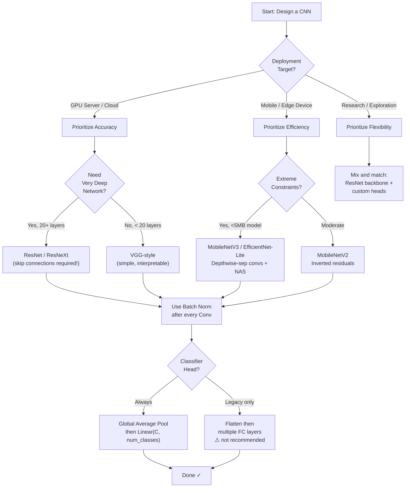

# Module 03 — CNN Architectures: Under the Hood

> **Track:** Computer Vision Lab  
> **Prerequisites:** Module 01 (PyTorch tensors), Module 02 (Training loop, loss curves)  
> **Notebook:** [`03_cnn_architectures.ipynb`](./03_cnn_architectures.ipynb)

---

## Table of Contents

1. [The Convolutional Layer — Full Anatomy](#1-the-convolutional-layer--full-anatomy)
2. [Receptive Field — Why Depth Matters](#2-receptive-field--why-depth-matters)
3. [Batch Normalization — The Stabilizer](#3-batch-normalization--the-stabilizer)
4. [Pooling — Spatial Compression](#4-pooling--spatial-compression)
5. [Skip Connections & ResNet](#5-skip-connections--resnet)
6. [Depthwise Separable Convolutions & MobileNet](#6-depthwise-separable-convolutions--mobilenet)
7. [Architecture Philosophy Comparison](#7-architecture-philosophy-comparison)
8. [Visual Reference Diagrams](#8-visual-reference-diagrams)
9. [Feynman Checkpoint Questions](#9-feynman-checkpoint-questions)

---

## 1. The Convolutional Layer — Full Anatomy

A convolutional layer is not just a "filter applied to an image." It is a parameterized linear operation with six independent knobs. Understanding each one is essential before you can debug shape errors, design custom architectures, or reason about model efficiency.

### 1.1 The Six Parameters

| Parameter | Type | What It Controls |
|-----------|------|-----------------|
| `in_channels` (C_in) | int | Number of feature maps entering the layer |
| `out_channels` (C_out) | int | Number of filters = number of output feature maps |
| `kernel_size` (k) | int or tuple | Spatial footprint of each filter |
| `stride` (s) | int or tuple | Step size of the sliding window |
| `padding` (p) | int or tuple | Zero-rows/columns added around input border |
| `dilation` (d) | int or tuple | Spacing between kernel elements (dilated/atrous conv) |

### 1.2 The Output Size Formula

For **each spatial dimension** (height and width independently):

```
output_size = floor( (input_size + 2·padding − dilation·(kernel_size − 1) − 1) / stride + 1 )
```

> **Why is this formula this shape?**  
> The numerator computes the effective size of the padded, dilated input that the kernel can traverse. Dividing by `stride` counts how many steps fit. Adding 1 counts the starting position.

### 1.3 Worked Examples

**Example A — Standard 3×3 conv, no padding:**
```
input:    H=32, W=32
kernel:   k=3, s=1, p=0, d=1

output_H = floor( (32 + 2·0 − 1·(3−1) − 1) / 1 + 1 )
         = floor( (32 + 0 − 2 − 1) / 1 + 1 )
         = floor( 29 + 1 ) = 30

Output: 30 × 30  ← shrinks by 2 per dimension
```

**Example B — "Same" padding (output == input size):**
```
input:    H=32, W=32
kernel:   k=3, s=1, p=1, d=1

output_H = floor( (32 + 2·1 − 1·(3−1) − 1) / 1 + 1 )
         = floor( (32 + 2 − 2 − 1) / 1 + 1 )
         = floor( 31 + 1 ) = 32

Output: 32 × 32  ← preserved!
```
> **Rule of thumb:** For k=3, p=1 preserves spatial size (with s=1). For k=5, p=2.  
> General: `p = (k - 1) / 2` for "same" padding with unit stride.

**Example C — Downsampling with stride=2:**
```
input:    H=32, W=32
kernel:   k=3, s=2, p=1, d=1

output_H = floor( (32 + 2·1 − 1·(3−1) − 1) / 2 + 1 )
         = floor( (32 + 2 − 2 − 1) / 2 + 1 )
         = floor( 31/2 + 1 )
         = floor( 15.5 + 1 )
         = floor( 16.5 ) = 16

Output: 16 × 16  ← spatial resolution halved
```
This is how ResNet uses `stride=2` for downsampling instead of pooling in some layers.

**Example D — Dilated convolution (d=2):**
```
input:    H=32, W=32
kernel:   k=3, s=1, p=2, d=2

Effective kernel footprint = d·(k−1)+1 = 2·(3−1)+1 = 5

output_H = floor( (32 + 2·2 − 2·(3−1) − 1) / 1 + 1 )
         = floor( (32 + 4 − 4 − 1) / 1 + 1 )
         = floor( 31 + 1 ) = 32

Output: 32 × 32  ← same size, but 5×5 receptive field with only 9 parameters!
```

### 1.4 Parameter Count for a Conv Layer

```
parameters = out_channels × (in_channels × kernel_h × kernel_w + bias)
```

For `nn.Conv2d(64, 128, kernel_size=3, bias=True)`:
```
= 128 × (64 × 3 × 3 + 1) = 128 × 577 = 73,856 parameters
```

---

## 2. Receptive Field — Why Depth Matters

### 2.1 What Is the Receptive Field?

The **receptive field** of a neuron in layer L is the region of the original input image that can influence that neuron's activation. It grows as you go deeper.

For a single conv layer with kernel size k, stride s=1:
```
Receptive Field = k
```

For two stacked conv layers each with k=3, s=1:
```
RF(layer 1) = 3
RF(layer 2) = 3 + (3 - 1) = 5
```

For L layers of k×k convolutions with s=1:
```
RF = L × (k - 1) + 1
```

### 2.2 Why Stack 3×3 Instead of Using 7×7?

Two stacked 3×3 convolutions give RF = 5.  
Three stacked 3×3 convolutions give RF = 7 — **same as one 7×7 convolution**.

But look at the parameter count:

| Option | Parameters (C channels) | Operations |
|--------|--------------------------|------------|
| One 7×7 conv | `C × C × 7 × 7 = 49C²` | 49C² MACs per pixel |
| Three 3×3 convs | `3 × C × C × 3 × 3 = 27C²` | 27C² MACs per pixel |

**Savings: 45% fewer parameters, 45% fewer operations — same receptive field.**

But that's not all. Each 3×3 conv has its own ReLU nonlinearity between them. Three conv layers = **two additional nonlinearities**. This means the network can learn more complex functions within the same receptive field. This was the key insight of **VGGNet (Simonyan & Zisserman, 2014)**.

### 2.3 Effective Receptive Field vs. Theoretical RF

In practice, not all pixels in the theoretical RF contribute equally. The effective RF is roughly Gaussian-shaped — center pixels dominate. This is why dilated convolutions (which explicitly expand RF without depth) are useful in tasks like semantic segmentation where you need large context but not maximum depth.

---

## 3. Batch Normalization — The Stabilizer

### 3.1 The Problem: Internal Covariate Shift

As training progresses, the weights in early layers change. This shifts the **distribution of activations** that later layers receive. Layer 10 has to keep re-adapting to a moving input distribution — like trying to aim at a target that's constantly changing position. This is called **internal covariate shift**, and it forces us to use very small learning rates and careful initialization.

### 3.2 The 4-Step Algorithm

Given a mini-batch B = {x₁, x₂, ..., xₘ} of activations:

**Step 1 — Compute batch mean:**
```
μ_B = (1/m) · Σᵢ xᵢ
```

**Step 2 — Compute batch variance:**
```
σ²_B = (1/m) · Σᵢ (xᵢ − μ_B)²
```

**Step 3 — Normalize:**
```
x̂ᵢ = (xᵢ − μ_B) / √(σ²_B + ε)
```
where ε ≈ 1e-5 prevents division by zero.

**Step 4 — Scale and shift with learnable parameters γ (gamma) and β (beta):**
```
yᵢ = γ · x̂ᵢ + β
```

γ and β are learned per-channel during backpropagation. This is crucial: it lets the network **undo** the normalization if the identity transform is optimal, so BatchNorm never restricts the model's representational power.

### 3.3 Why It Works in CNNs

1. **Smooths the loss landscape.** Normalized activations keep gradient magnitudes in a sane range throughout all layers simultaneously.
2. **Allows higher learning rates.** With stable distributions, you can push LR higher without divergence — faster training.
3. **Acts as regularization.** Because normalization statistics are computed per-batch, each sample is normalized with slightly different statistics each time — a form of stochastic noise that reduces overfitting.
4. **Reduces sensitivity to initialization.** Bad initialization creates very large or very small activations. BatchNorm corrects these at every layer automatically.

### 3.4 BatchNorm Placement in CNNs

Standard practice: `Conv → BatchNorm → ReLU`  
(Some architectures use "Pre-activation ResNet": `BatchNorm → ReLU → Conv`)

```python
# Standard order
nn.Sequential(
    nn.Conv2d(64, 128, 3, padding=1),
    nn.BatchNorm2d(128),   # normalizes per channel across H, W, N
    nn.ReLU(inplace=True),
)
```

> **Note:** `nn.BatchNorm2d` normalizes across the (N, H, W) dimensions, keeping C separate. This means each channel gets its own μ, σ, γ, β — 4 × C learnable parameters total.

### 3.5 Training vs. Inference Behavior

- **Training:** μ and σ computed from the current mini-batch. Running estimates are maintained via exponential moving average.
- **Inference:** Stored running mean/variance are used (not the batch). The layer becomes a fixed linear transform — no stochasticity.

This is why you must call `model.train()` and `model.eval()` correctly.

---

## 4. Pooling — Spatial Compression

### 4.1 Max Pooling

Slides a window and takes the **maximum** value. 

```
Input (4×4):        MaxPool 2×2, s=2:
1  3  2  4          3  4
5  6  7  8    →     6  8
9  10 11 12         10 12
13 14 15 16         14 16
```

**Why max?** Detects *whether* a feature is present in a region. Edges, textures — presence matters more than average response. Introduces **translation invariance**: small shifts in input don't change the output.

### 4.2 Average Pooling

Slides a window and takes the **mean** value.

```
Input (4×4):        AvgPool 2×2, s=2:
1  3  2  4          (1+3+5+6)/4=3.75  (2+4+7+8)/4=5.25
5  6  7  8    →     (9+10+13+14)/4=11.5  (11+12+15+16)/4=13.5
9  10 11 12
13 14 15 16
```

**Why average?** Preserves distributed information. Used in ResNet's "downsampling" and in the final Global Average Pooling layer.

### 4.3 Global Average Pooling (GAP)

Takes the **mean of the entire feature map** per channel. A feature map of shape `(B, C, H, W)` becomes `(B, C)`.

```python
gap = nn.AdaptiveAvgPool2d(1)  # outputs (B, C, 1, 1)
# then flatten to (B, C)
```

### 4.4 Why GAP > Flattening for the Classifier

**Flattening** approach: `(B, 512, 7, 7)` → flatten → `(B, 25088)` → `Linear(25088, 1000)`
- Parameters in that Linear: `25,088 × 1,000 = 25M` — this single layer dwarfs everything else!
- Overfit-prone: memorizes spatial positions, not semantic content.
- Breaks if input size changes.

**GAP approach:** `(B, 512, 7, 7)` → GAP → `(B, 512)` → `Linear(512, 1000)`
- Parameters: `512 × 1,000 = 512K` — 50× fewer.
- Each channel in the final feature map becomes an explicit "confidence score" for a class-specific pattern.
- **Works on any input size** — the GAP averages over whatever spatial extent exists.
- Strongly regularizing — the network must learn globally meaningful channels, not position-specific patterns.

> **The semantic meaning:** In a network trained on ImageNet, if channel 42 of the final conv layer fires strongly for "wheel" patterns, GAP turns that into a clean scalar representing "how much wheel-ness is in this image overall," which then directly informs the "bicycle" class prediction.

---

## 5. Skip Connections & ResNet

### 5.1 The Degradation Problem

In 2015, Microsoft Research found something disturbing: adding more layers to a *plain* (VGG-style) network made training loss **worse**, not better. A 56-layer plain net had higher training error than a 20-layer plain net on CIFAR-10.

This is not overfitting — the training error itself was higher. The deeper network was harder to optimize. The gradients, backpropagated through 56 layers of `tanh` or `ReLU` activations, became vanishingly small by the time they reached early layers. Early layers stopped learning. 

### 5.2 The Residual Learning Framework

He et al. (2015) proposed a simple fix: instead of asking each block to learn the mapping H(x), ask it to learn the **residual** F(x) = H(x) − x, then compute H(x) = F(x) + x via a skip connection.

```
H(x) = F(x) + x
```

The identity shortcut `x` bypasses the conv layers entirely. This changes the optimization landscape dramatically:

- **If the optimal function is close to identity** (common in deep nets), F(x) → 0 is much easier to learn than H(x) → x directly.
- **Gradient highways:** During backprop, the gradient of the loss with respect to x flows through the addition gate — a direct, unobstructed path from the output all the way to the input. Gradients can travel across hundreds of layers without being multiplied through dozens of weight matrices.

### 5.3 The Math of Why Skip Connections Fix Gradients

For a chain of residual blocks:

```
x_L = x_l + Σ F(x_i, W_i)   [for layers l to L]
```

The gradient with respect to x_l:

```
∂loss/∂x_l = ∂loss/∂x_L · (1 + ∂/∂x_l Σ F(x_i, W_i))
```

That **`1 +`** term is the key. Even if the derivative of F is zero, the gradient still flows as `∂loss/∂x_L`. The gradient can never fully vanish.

### 5.4 ASCII Diagram — Residual Block

```
                     INPUT x
                    /        \
                   /          \
          ┌────────────┐       │  (identity shortcut)
          │  Conv 3×3  │       │
          │  BN + ReLU │       │
          └────────────┘       │
                 │             │
          ┌────────────┐       │
          │  Conv 3×3  │       │
          │  BN        │       │
          └────────────┘       │
                 │             │
                 └──── (+) ────┘
                       │
                     ReLU
                       │
                     OUTPUT F(x) + x
```

> **Note on the downsampling shortcut:** When stride=2 is used to reduce spatial size, the skip connection uses a `1×1 Conv + BN` (also strided) to match dimensions. This is the "projection shortcut" — still one operation vs. the two-layer block.

---

## 6. Depthwise Separable Convolutions & MobileNet

### 6.1 The Problem with Standard Convolutions

A standard Conv2d(M, N, k) layer applies N filters, each of size `k × k × M` (touching all input channels simultaneously). This is powerful but expensive.

**Parameter count:** `D_k² × M × N`  
**FLOP count per output pixel:** `D_k² × M × N`

For a 3×3 conv with M=64 input channels, N=128 output channels:
```
Parameters = 3² × 64 × 128 = 73,728
```

### 6.2 Decomposition: Depthwise + Pointwise

MobileNet (Howard et al., 2017) decomposes this one conv into two:

**Step 1 — Depthwise Conv:** Apply one `k × k` filter **per input channel** independently (groups=M in PyTorch).

```
Parameters_DW = D_k² × M × 1 = D_k² × M
```

Each filter only sees one channel. No cross-channel mixing yet.

**Step 2 — Pointwise Conv (1×1):** Apply N filters of size `1 × 1 × M` to mix channels.

```
Parameters_PW = 1 × 1 × M × N = M × N
```

**Total parameters:**
```
D_k² × M + M × N
```

### 6.3 The Reduction Formula

```
Reduction = (D_k² × M + M × N) / (D_k² × M × N)
           = 1/N + 1/D_k²
```

For 3×3 conv (D_k = 3):
```
Reduction = 1/N + 1/9
```
As N grows large, this approaches **1/9 ≈ 8-9× reduction**.

### 6.4 Concrete Example: 3×3, 64→128 channels

| Operation | Parameters |
|-----------|-----------|
| Standard Conv2d(64, 128, 3) | 3² × 64 × 128 = **73,728** |
| Depthwise Conv2d(64, 64, 3, groups=64) | 3² × 64 = **576** |
| Pointwise Conv2d(64, 128, 1) | 1 × 64 × 128 = **8,192** |
| **Depthwise-Separable Total** | 576 + 8,192 = **8,768** |
| **Reduction Factor** | 73,728 / 8,768 = **8.41×** |

### 6.5 Quality Tradeoff

The depthwise step prevents cross-channel mixing within the spatial convolution. The spatial structure and the channel mixing are learned **separately** rather than jointly. In practice, the quality drop on ImageNet is surprisingly small — MobileNetV1 achieves ~70.6% top-1 accuracy at 4.2M parameters, compared to VGG-16 at ~71.5% with 138M parameters. The 33× parameter reduction at similar accuracy is the core value proposition for mobile/edge deployment.

---

## 7. Architecture Philosophy Comparison

| | **VGGNet (2014)** | **ResNet (2015)** | **MobileNet (2017)** |
|--|---|---|---|
| **Core idea** | Stack 3×3 convs for deep RF; use depth for power | Residual learning solves degradation at extreme depth | Depthwise-separable convs for efficiency |
| **Depth** | 11–19 layers | 18–152 layers (and beyond with ResNeXt) | 28 layers (V1), variable (V2/V3) |
| **Skip connections** | ❌ None | ✅ Residual blocks | ✅ Inverted residual blocks (V2+) |
| **Batch Norm** | ❌ Not used originally | ✅ After every conv | ✅ After every conv |
| **Global Avg Pool** | ❌ Uses FC layers | ✅ GAP before FC | ✅ GAP before FC |
| **Parameters** | 138M (VGG-16) | 11M (ResNet-18), 25M (ResNet-50) | 4.2M (V1), ~3.4M (V2) |
| **Training stability** | Brittle (careful init needed) | Robust (trains to 1000 layers) | Robust |
| **Target platform** | Research / GPU servers | Research / production GPU | Mobile / edge / embedded |
| **Bottleneck blocks** | ❌ | ✅ 1×1 → 3×3 → 1×1 (ResNet-50+) | ✅ Inverted bottleneck (V2) |
| **Normalization** | None | BatchNorm | BatchNorm |
| **Inference speed** | Slow (too many params) | Moderate | Fast (purpose-built) |
| **Legacy** | Proved depth + 3×3 stacking | Enabled training of 1000+ layer nets | Defined efficient CNN design |

---

## 8. Visual Reference Diagrams

### 8.1 Residual Block (Full Detail)

```
   x (input)
   │
   ├─────────────────────────────────────┐
   │                                     │  SHORTCUT PATH
   │                                     │  (identity OR 1×1 conv
   ▼                                     │   if dims change)
┌──────────────────────┐                 │
│  Conv2d(C, C, 3×3)   │                 │
│  padding=1           │                 │
└──────────────────────┘                 │
   │                                     │
┌──────────────────────┐                 │
│  BatchNorm2d(C)       │                 │
└──────────────────────┘                 │
   │                                     │
┌──────────────────────┐                 │
│  ReLU                │                 │
└──────────────────────┘                 │
   │                                     │
┌──────────────────────┐                 │
│  Conv2d(C, C, 3×3)   │                 │
│  padding=1           │                 │
└──────────────────────┘                 │
   │                                     │
┌──────────────────────┐                 │
│  BatchNorm2d(C)       │                 │
└──────────────────────┘                 │
   │                                     │
   └──────────── (+) ◄───────────────────┘
                  │
┌──────────────────────┐
│  ReLU                │
└──────────────────────┘
   │
   ▼
F(x) + x  (output)
```

### 8.2 Depthwise Separable Convolution

```
INPUT FEATURE MAP: (B, 64, H, W)
│
│  DEPTHWISE STEP: 64 separate 3×3 filters, one per channel
│  Each filter ONLY processes its own channel — no mixing
│
├─── Channel 0 ─── [3×3 filter_0] ───► output_ch0 (H×W)
├─── Channel 1 ─── [3×3 filter_1] ───► output_ch1 (H×W)
├─── Channel 2 ─── [3×3 filter_2] ───► output_ch2 (H×W)
│         ...                                ...
└─── Channel 63 ── [3×3 filter_63] ──► output_ch63 (H×W)
                                              │
                               Stacked: (B, 64, H, W)
                                              │
│  POINTWISE STEP: 128 filters of size 1×1×64
│  Mix ALL channels at each spatial position
│  (standard conv with k=1, no spatial processing)
│
                    [128× (1×1×64 filters)]
                                              │
                                              ▼
                              OUTPUT: (B, 128, H, W)
```

### 8.3 Mermaid Flowchart — How Architecture Choice Flows from Constraints



---

## 9. Feynman Checkpoint Questions

> These questions are designed to test *deep understanding*, not recall. Write your answers in the **Section 4** of the notebook before looking at the model solutions.

---

### ❓ Question 1 — The Degradation Problem

> *"Your friend says 'deeper is always better — just stack more conv layers.' Why is this wrong, and what specific problem did ResNet solve? Explain using the training loss curves you saw in the sabotage lab."*

**What a good answer covers:**
- Deeper plain networks can have **higher training loss** (not just validation loss) than shallower ones — this rules out overfitting as the explanation.
- The root cause: vanishing gradients through many sequential nonlinear transformations. Early layers receive near-zero gradient signal and stop learning useful features.
- In the sabotage lab: the 20-layer plain network's training loss curve plateaus or diverges early, while the equivalent ResNet-style network continues to decrease smoothly.
- ResNet solved this by adding a **direct gradient path** via the identity shortcut: `∂loss/∂x = ∂loss/∂F(x) + ∂loss/∂(identity) = ... + 1`. The gradient always has a unit-magnitude component flowing directly to earlier layers.
- The key insight: ResNet doesn't make gradients *larger* — it prevents them from becoming *zero*.

---

### ❓ Question 2 — Batch Normalization, Explained to a Statistician

> *"Explain Batch Normalization to someone who knows statistics but not deep learning. What problem does it solve and why does it help training be more stable?"*

**What a good answer covers:**
- Framing the problem statistically: in a neural network, each layer's input distribution changes as upstream weights change during gradient descent. This is like trying to fit a linear model where the feature distribution shifts every iteration — slow and unstable.
- BatchNorm standardizes each feature (channel) to zero mean and unit variance within each mini-batch — exactly like z-score normalization in statistics.
- The learnable γ and β restore the model's ability to represent any distribution — the normalization is undone if needed. This is crucial: unlike hard normalization, BatchNorm cannot reduce model capacity.
- Statistical analogy: it's like whitening the inputs at every hidden layer, not just the input layer. Whitened inputs are known to improve the conditioning of least-squares problems — the same principle applies to gradient descent in neural networks.
- The stochastic aspect: since μ and σ are estimated from the mini-batch (not the full dataset), there's noise in the normalization. This noise acts as regularization (similar to dropout), reducing overfitting slightly.

---

### ❓ Question 3 — MobileNet's Depthwise Separable Convolutions

> *"MobileNet uses depthwise separable convolutions. Explain to a non-ML engineer why this is clever — specifically: what computation is being avoided and what is the quality tradeoff?"*

**What a good answer covers:**
- Analogy: a standard conv applies **one combined operation** that learns spatial patterns AND channel relationships simultaneously. This is like a committee that simultaneously decides what to look at AND how to weigh everyone's input.
- A depthwise-separable conv splits this into two simpler operations: first, each channel looks for spatial patterns on its own (depthwise); then a 1×1 conv mixes the results across channels (pointwise). Two specialists instead of one generalist committee.
- The avoided computation: in standard conv, every filter looks at all input channels at once. With M=64 input channels and a 3×3 kernel, each output channel needs 9×64 = 576 multiplications per pixel. With depthwise-sep, each channel does its own 9 multiplications (depthwise), and then 64 multiplications per pixel in the pointwise step. That's 9 + 64 = 73 operations instead of 576 — roughly 8× fewer.
- Quality tradeoff: spatial patterns and channel interactions are learned **independently** rather than jointly. This can miss some cross-channel spatial patterns. In practice, the accuracy drop is very small (~1-3% on ImageNet) while the speed and memory gains are 8-9×. For deployment on a phone, this tradeoff is excellent.

---

*End of Module 03 README*

---

> **Next:** Open [`03_cnn_architectures.ipynb`](./03_cnn_architectures.ipynb) and work through all four sections in order. Complete the Feynman answers in Section 4 before running the provided solution cells.
