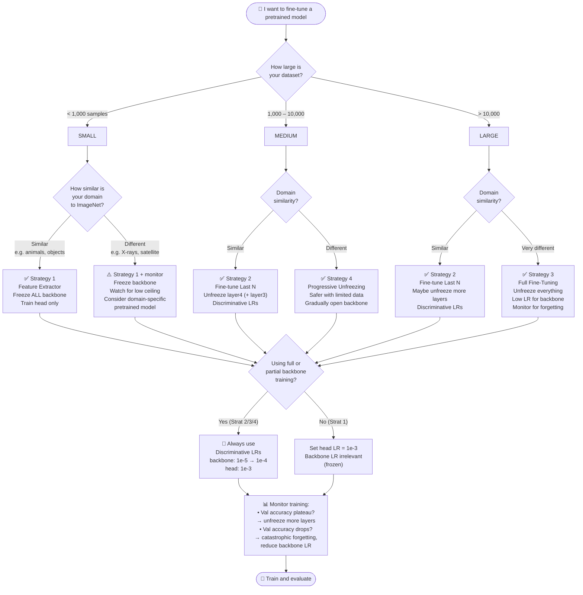

# Module 04 — Advanced Transfer Learning

> **Track:** Computer Vision Lab  
> **Prerequisites:** Module 03 (Transfer Learning Basics), basic PyTorch, understanding of CNNs  
> **Notebook:** [`04_advanced_transfer_learning.ipynb`](./04_advanced_transfer_learning.ipynb)  
> **Estimated Time:** 3–4 hours

---

## Table of Contents

1. [What Lives Inside Pretrained Weights?](#1-what-lives-inside-pretrained-weights)
2. [The Feature Hierarchy](#2-the-feature-hierarchy)
3. [Four Fine-Tuning Strategies](#3-four-fine-tuning-strategies)
4. [Discriminative Learning Rates](#4-discriminative-learning-rates)
5. [Catastrophic Forgetting](#5-catastrophic-forgetting)
6. [Domain Gap](#6-domain-gap)
7. [ASCII Layer-Freeze Map](#7-ascii-layer-freeze-map)
8. [Decision Flowchart](#8-decision-flowchart)
9. [Feynman Checkpoint](#9-feynman-checkpoint)

---

## 1. What Lives Inside Pretrained Weights?

When a model like ResNet50 trains on ImageNet — 1.2 million images, 1000 classes, often for days on dozens of GPUs — it is not simply memorizing images. It is building a **compressed, hierarchical description of the visual world**.

The resulting weights are a frozen encyclopedia of visual knowledge:

- **Low-level detectors** (early layers): Gabor-like edge filters, color gradients, orientation detectors. These are nearly universal — they appear in any vision model trained on any natural image dataset.
- **Mid-level combiners** (middle layers): Textures (wood grain, fur, scales), simple shapes (circles, corners, grids), repeated patterns.
- **High-level concepts** (deep layers): Semantic object parts — wheel-ness, eye-ness, feather-ness. Features that say "this patch looks like the front of a car."

This knowledge took millions of samples and massive compute to acquire. **Transfer learning lets you inherit it for free.**

---

## 2. The Feature Hierarchy

```
Input Image
    │
    ▼
┌──────────────────────────────────────────────────────────┐
│  Layer Group 1 (conv1, bn1, relu, maxpool)               │
│  → Edges: horizontal, vertical, diagonal lines           │
│  → Colour blobs, low-frequency patterns                  │
│  Receptive field: ~7×7 pixels                            │
└─────────────────────────┬────────────────────────────────┘
                          │
                          ▼
┌──────────────────────────────────────────────────────────┐
│  Layer Group 2 (layer1)                                  │
│  → Textures: stripes, dots, grids                        │
│  → Simple junctions and T-shapes                         │
│  Receptive field: ~35×35 pixels                          │
└─────────────────────────┬────────────────────────────────┘
                          │
                          ▼
┌──────────────────────────────────────────────────────────┐
│  Layer Group 3 (layer2)                                  │
│  → Composed textures: fur, grass, fabric                 │
│  → Partial shapes: arcs, concentric rings                │
│  Receptive field: ~90×90 pixels                          │
└─────────────────────────┬────────────────────────────────┘
                          │
                          ▼
┌──────────────────────────────────────────────────────────┐
│  Layer Group 4 (layer3)                                  │
│  → Object parts: wheel, eye, snout, wing                 │
│  → Compositional structures                              │
│  Receptive field: ~200×200 pixels                        │
└─────────────────────────┬────────────────────────────────┘
                          │
                          ▼
┌──────────────────────────────────────────────────────────┐
│  Layer Group 5 (layer4)                                  │
│  → Whole-object semantics: "car-ness", "dog-ness"        │
│  → Class-discriminative feature vectors                   │
│  Receptive field: full image                             │
└─────────────────────────┬────────────────────────────────┘
                          │
                          ▼
┌──────────────────────────────────────────────────────────┐
│  Classifier Head (avgpool + fc)                          │
│  → Maps 512-d vector → class logits                      │
│  → This is the ONLY part that is task-specific           │
└──────────────────────────────────────────────────────────┘
```

**Key insight:** Early layers are almost always transferable. Deep layers are increasingly task-specific. The head is entirely task-specific.

---

## 3. Four Fine-Tuning Strategies

### Strategy 1 — Feature Extractor Only

**What you do:** Freeze **all** backbone layers. Train only the new classifier head (the FC layer you replaced).

**Why it works:** The backbone already extracts rich features. The head just needs to learn a linear mapping from those features to your new classes. Very few parameters to train, very stable.

**When to use:**
- **Small dataset** (< ~1000 samples per class) — the backbone cannot be safely updated without overfitting.
- **Similar domain** to ImageNet — natural photographs, everyday objects. The pretrained features are already good enough.
- When you need fast iteration or limited compute.

**Trade-off:** You're fundamentally limited by the quality of pretrained features for your task. If the domain is different, performance ceiling is low.

---

### Strategy 2 — Fine-Tune Last N Layers

**What you do:** Freeze early backbone layers (layer1, layer2). Unfreeze the last N layer groups (layer3, layer4) and the head. Train all unfrozen parameters.

**Why it works:** You preserve the universal low-level features (edges, textures — these don't need to change) while allowing the high-level, task-specific features to adapt to your data.

**When to use:**
- **Medium dataset** (~1000–10,000 samples) — enough data to safely update some backbone parameters.
- **Somewhat similar domain** — the low-level features transfer well but the high-level semantics need adjustment.
- A good default strategy for most practical fine-tuning tasks.

**Trade-off:** Choosing N requires some judgment. Typically start with N=1 (unfreeze only layer4) and increase if validation performance saturates.

---

### Strategy 3 — Full Fine-Tuning

**What you do:** Unfreeze **all** layers. Train the entire network end-to-end with the pretrained weights as initialization.

**Why it works:** The pretrained weights are an excellent starting point. Full fine-tuning lets every layer adapt to the target task. The network converges much faster and to better optima than training from scratch.

**When to use:**
- **Large dataset** (tens of thousands+ samples per class) — enough data to update all parameters without overfitting.
- **Different domain** from ImageNet — medical images, satellite imagery, microscopy. The high-level ImageNet features are misleading; the network needs to relearn them.
- When you want the absolute best possible performance and have compute budget.

**Trade-off:** High risk of catastrophic forgetting if learning rate is too high. Must use very low LR for backbone (see §4). Slow and expensive.

---

### Strategy 4 — Progressive Layer Unfreezing

**What you do:** Start with everything frozen (Strategy 1). Train until convergence. Then unfreeze layer4, train more. Then unfreeze layer3, train more. Continue until you've unfrozen everything, or until performance stops improving.

**Why it works:** The head learns first with stable features. Then layer4 adapts, guided by a well-trained head signal. Then layer3 adapts, guided by a well-trained layer4. The gradient signal is always meaningful — you never push random gradients into the backbone from an untrained head.

**When to use:**
- Any situation, but especially medium datasets.
- When you want the benefits of full fine-tuning without the instability.
- When you're unsure about dataset size or domain similarity.
- The "best of all worlds" strategy — most robust default.

**Trade-off:** Slower to implement. Requires more training epochs and careful scheduling.

---

### Strategy Comparison at a Glance

| Strategy | Backbone Frozen | Parameters Trained | Dataset Size | Domain Similarity |
|---|---|---|---|---|
| Feature Extractor | Fully frozen | Head only | Small (<1K) | Similar |
| Last N Layers | Partially frozen | Head + last N | Medium (1K–10K) | Somewhat similar |
| Full Fine-Tuning | Fully unfrozen | All layers | Large (>10K) | Different |
| Progressive | Gradually unfrozen | Grows over time | Any | Any |

---

## 4. Discriminative Learning Rates

**The core problem:** Your new classifier head has been randomly initialized and knows nothing. The pretrained backbone layers have been carefully tuned over millions of samples and know a lot. If you use the same learning rate for both, you destroy the backbone.

**The solution:** Use a different learning rate for each layer group — lower for layers that are already good, higher for layers that need to learn.

### The Intuition

Think of it like renovating a house you just bought:
- The **foundation and load-bearing walls** (early layers): almost perfect, don't touch them. Use a tiny chisel (LR ≈ 1e-5).
- The **interior layout** (middle layers): mostly good, minor adjustments. Use a small hammer (LR ≈ 1e-4).
- The **furniture and decor** (head): completely wrong for you, needs full replacement. Use a wrecking ball (LR ≈ 1e-3).

### Typical LR Schedule for ResNet18

```python
param_groups = [
    {'params': model.layer1.parameters(), 'lr': 1e-5},   # Foundational — barely move
    {'params': model.layer2.parameters(), 'lr': 2e-5},   # Stable textures — tiny nudge
    {'params': model.layer3.parameters(), 'lr': 5e-5},   # Object parts — moderate
    {'params': model.layer4.parameters(), 'lr': 1e-4},   # High-level — adapt more
    {'params': model.fc.parameters(),     'lr': 1e-3},   # Head — learn from scratch
]
optimizer = torch.optim.Adam(param_groups)
```

**The LR gradient:** `1e-5 → 2e-5 → 5e-5 → 1e-4 → 1e-3`

Each group has a LR roughly 2–10× higher than the previous. The head's LR is 100× the earliest backbone layers.

### Why Not Just Use Weight Decay?

Weight decay (L2 regularization) penalizes large weights uniformly — it helps prevent overfitting but does not discriminate between layers that are already good vs. layers that need to change. Discriminative LRs are complementary to, not a substitute for, weight decay.

---

## 5. Catastrophic Forgetting

### What Is It?

Catastrophic forgetting (also called catastrophic interference) occurs when a neural network, trained on a new task, rapidly overwrites the weights it had learned for a previous task — destroying the previously acquired knowledge.

In transfer learning: you've inherited weights that encode rich visual features from ImageNet. If you fine-tune aggressively (high LR, all layers unfrozen), gradient descent will overwrite those features to fit your small new dataset. The network "forgets" how to see edges, textures, and object parts — replacing them with patterns that only work for your specific task, often with severe overfitting.

### When It Happens

- **High learning rate** for backbone layers (e.g., LR = 0.01 everywhere)
- **Full fine-tuning** from epoch 1 without warming up the head
- **Small dataset** — not enough data to converge to good weights, so the backbone thrashes
- **Many epochs** with aggressive augmentation on a head that hasn't stabilized

### What It Looks Like

- Training loss drops quickly (the model is memorizing).
- Validation accuracy plateaus or **degrades** over time.
- Features extracted from the backbone look increasingly random (see Section 3 of the notebook).
- The PCA of feature embeddings collapses — classes that were separated become entangled.

### How to Prevent It

| Prevention Method | Mechanism |
|---|---|
| **Discriminative LRs** | Backbone sees tiny gradients; only head changes drastically. |
| **Progressive unfreezing** | Backbone is updated only after head is stable; gradient signal is meaningful. |
| **Lower overall LR** | Smaller steps → less overwriting per update. |
| **Warmup phase** | Train head only first; then open backbone with low LR. |
| **Gradient clipping** | Cap gradient norms so no single step destroys weights. |
| **Early stopping** | Stop before the model begins overfitting. |
| **Elastic Weight Consolidation (EWC)** | Penalize change to weights important for the old task (advanced). |

### Human Memory Analogy

Imagine you speak fluent French (the pretrained knowledge). You now move to Japan and are immersed in Japanese 24/7. If you never speak French again, after months, you'll start to forget French — Japanese has **overwritten** the neural pathways you used for French. Catastrophic forgetting in neural networks is the same: intensive training on new data overwrites the weights that encoded old knowledge.

---

## 6. Domain Gap

### The Fundamental Question: Pretrained or From Scratch?

ImageNet-pretrained weights are an extraordinary resource, but they are not universally applicable. The effectiveness of transfer depends on the **domain gap**: how different your target dataset is from ImageNet.

### Natural Image Domain (Small Gap)

- **Examples:** Flowers, animals, vehicles, everyday objects, food.
- **Outcome:** ImageNet pretrained weights transfer almost perfectly. Even Strategy 1 (frozen backbone) gives strong results.
- **Recommendation:** Always use pretrained weights. Train from scratch would be wasteful.

### Remote Sensing / Satellite Imagery (Moderate Gap)

- **Examples:** Aerial views of roads, buildings, agriculture, forests.
- **What transfers:** Low-level edge and texture features still apply. High-level features (car-ness, dog-ness) are largely useless.
- **Outcome:** Fine-tuning with discriminative LRs or progressive unfreezing works well.
- **Recommendation:** Use pretrained + full fine-tuning. Consider using models pretrained on satellite-specific datasets (e.g., BigEarthNet) for better initialization.

### Medical Imaging — X-ray, MRI, Pathology (Large Gap)

- **Examples:** Chest X-ray pathology detection, tumor segmentation in CT, cancer classification in histology slides.
- **What transfers:** Very low-level features (edge detectors) may help. Everything above layer1 is suspect.
- **The problem:** ImageNet weights encode "photo-realism" priors. X-rays have reversed contrast (dense tissue is bright), single-channel input, and entirely different semantic structure. Layer4 features that detect "dog ear" are actively harmful for detecting pneumothorax.
- **Outcome:** Results vary widely. Pretrained ResNet on X-rays often outperforms random init due to optimization landscape benefits, but the advantage is smaller than in natural images.
- **Recommendation:** Run the experiment both ways. Use pretrained as initialization but fully fine-tune with low LR. Consider domain-specific pretrained models (CheXNet, BioViL, etc.) if available.

### Microscopy / Scientific Imaging (Large Gap)

- **Examples:** Cell segmentation, particle detection, fluorescence microscopy.
- **What transfers:** Very little. The visual statistics are fundamentally different.
- **Recommendation:** Train from scratch if dataset is large (>50K images). Use pretrained only as initialization if dataset is small, with full fine-tuning.

### Decision Rule of Thumb

```
Dataset Size ↑  ×  Domain Gap ↑  →  More justification to train from scratch
Dataset Size ↓  ×  Domain Gap ↓  →  Feature Extractor (Strategy 1) is sufficient
Dataset Size ↓  ×  Domain Gap ↑  →  Pretrained + full fine-tune (low LR) is best bet
                                     (even imperfect pretrained beats random init with small data)
```

> **The key experiment:** Always compare (a) pretrained + fine-tuned vs. (b) random init + trained. If (a) is not meaningfully better, your domain gap is too large for the pretrained features to help.

---

## 7. ASCII Layer-Freeze Map

```
ResNet18 LAYER-FREEZE MAP — 4 STRATEGIES
═══════════════════════════════════════════════════════════════════════
Layer Group         Params    Strat 1   Strat 2   Strat 3   Strat 4
                              (Extrac)  (Last N)  (Full)    (Progres)
───────────────────────────────────────────────────────────────────────
conv1 + bn1          9,408    ❄ FROZEN  ❄ FROZEN  🔥 TRAIN  ❄→🔥 Step4
layer1 (ResBlk×2)   147,968   ❄ FROZEN  ❄ FROZEN  🔥 TRAIN  ❄→🔥 Step4
layer2 (ResBlk×2)   525,312   ❄ FROZEN  ❄ FROZEN  🔥 TRAIN  ❄→🔥 Step3
layer3 (ResBlk×2) 1,182,720   ❄ FROZEN  ❄ FROZEN  🔥 TRAIN  ❄→🔥 Step2
layer4 (ResBlk×2) 2,099,200   ❄ FROZEN  🔥 TRAIN  🔥 TRAIN  ❄→🔥 Step1
───────────────────────────────────────────────────────────────────────
avgpool                  —    🔥 TRAIN  🔥 TRAIN  🔥 TRAIN  🔥 TRAIN
fc (new head)       81,930    🔥 TRAIN  🔥 TRAIN  🔥 TRAIN  🔥 TRAIN
═══════════════════════════════════════════════════════════════════════
Trainable params:   82K       82K       2.18M     11.17M    Grows
% of total:         0.7%      0.7%      19.5%     100%      0.7→100%
═══════════════════════════════════════════════════════════════════════

❄ = Frozen (requires_grad=False)
🔥 = Trainable (requires_grad=True)
❄→🔥 = Progressive: starts frozen, unfreezes at step shown

Progressive Unfreezing Timeline (Strat 4):
  Epochs 0–4:   Only fc trains          (82K params)
  Epochs 5–9:   + layer4 unfreezes      (+2.1M params)
  Epochs 10–14: + layer3 unfreezes      (+1.2M params)
  Epochs 15–19: + layers 1,2 unfreeze   (+675K params)
```

---

## 8. Decision Flowchart



---

## 9. Feynman Checkpoint

> **How to use these:** Don't look up the answers. Close the module. Write your answers on paper or in a markdown cell. Then come back and compare. If you can't answer without looking, you don't know it yet.

---

### ❓ Question 1

> *"Imagine you trained ResNet50 on ImageNet for 3 weeks on 8 GPUs. Now you want to classify 10 species of mushrooms with only 200 photos. Which of the 4 fine-tuning strategies do you choose and why? Walk through your reasoning."*

**What a strong answer covers:**

Start by noting the two key variables: **dataset size = very small (200 photos = 20 per class)** and **domain = natural images (mushrooms are photographed in the wild, very similar to ImageNet content)**.

With only 200 samples, any attempt to update the backbone will overfit catastrophically — you simply don't have enough data to constrain thousands of backbone parameters. The risk of destroying the pretrained features is enormous.

The domain is similar (natural photographs of organisms), so the pretrained features are directly useful: layer1 detects the edges and textures of mushroom caps, layer3 detects the radial symmetry and stem shapes.

**The answer is Strategy 1: Feature Extractor.** Freeze the entire backbone. Replace the final FC layer with a new 10-class head and train only that head. With 200 samples, you're essentially running logistic regression over the 2048-d ImageNet feature space — which is powerful precisely because those features are general and already rich.

**Bonus insight:** With 200 images, you might also explore data augmentation aggressively (flips, crops, color jitter, even MixUp), since the head is your only trainable component. You might also try k-NN classification in the feature space as a baseline before even training the head.

---

### ❓ Question 2

> *"Explain catastrophic forgetting to a non-ML person using a human memory analogy. What is the neural network equivalent? How do discriminative learning rates prevent it?"*

**What a strong answer covers:**

**The analogy:** Imagine you are a concert pianist who has spent 10 years mastering Bach. You decide to learn jazz. You practice jazz exclusively, 8 hours a day, for 6 months. At the end, you're a decent jazz player — but you try to play Bach and you've lost it. Your muscle memory for Bach's precise fingering has been overwritten by jazz improvisation patterns. This is catastrophic forgetting.

**The neural network equivalent:** The pretrained weights in a CNN are like the "muscle memory" for visual features — learned over millions of examples. When you train aggressively on a new task (high LR, all layers open), gradient descent updates the weights in the direction of the new task's loss. If the update steps are too large, the weight values that encoded "edge detector" or "fur texture" are simply overwritten with values that encode something about your specific new dataset. The next time you use the network on a natural image, those features are gone.

**How discriminative LRs prevent it:** Discriminative LRs are like saying: "I will use my right hand (head) for intensive jazz practice, but my left hand (backbone) will only do tiny maintenance exercises." The backbone weights change by tiny amounts per step — not enough to overwrite the precious pretrained information, but enough to slowly adapt. Meanwhile the head changes quickly, learning the new mapping. The features are preserved; only the mapping is aggressively updated.

---

### ❓ Question 3

> *"A team fine-tuned ResNet50 on chest X-rays and got bad results. A colleague suggests: just use ImageNet weights, everyone else does. Another says: train from scratch for medical images. Who is right and why? What experiment would you run to decide?"*

**What a strong answer covers:**

**Neither is fully right** — and both have a valid partial argument.

The "use ImageNet" colleague is right that ImageNet pretrained weights often still help even in medical imaging — not because the high-level features transfer, but because the optimization landscape benefits (the weights are a good starting point even if imperfect) and low-level features (edge detectors) still apply to X-rays.

The "train from scratch" colleague is right that the high-level ImageNet features (dog ears, car wheels) are actively irrelevant and potentially misleading for chest pathology detection. If you have enough data, training from scratch (or using a medically-pretrained model like CheXNet) may surpass ImageNet fine-tuning.

**The key diagnostic questions:**
1. How large is the chest X-ray dataset? (<10K → pretrained almost always wins; >100K → scratch becomes competitive)
2. What specifically went wrong? Low accuracy from epoch 1 (bad features) or degrading over time (catastrophic forgetting)?
3. Were discriminative LRs used? If they used flat LR=0.01 on all layers, forgetting is the likely culprit — not the pretrained weights themselves.

**The experiment:** Run three conditions in parallel:
- **A:** ResNet50 ImageNet pretrained, frozen backbone (Strategy 1) → tests if ImageNet features are useful at all for X-rays
- **B:** ResNet50 ImageNet pretrained, full fine-tune with discriminative LRs (Strategy 3 properly done)
- **C:** ResNet50 randomly initialized, full training from scratch

Compare validation AUC (not accuracy — X-ray datasets are often imbalanced). If A > C at any dataset size, ImageNet features help. If B > A, fine-tuning is beneficial. If C ≥ B with enough data, the domain gap is too large. The answer almost certainly depends on dataset size.

---

## Further Reading

- [Visualizing and Understanding Convolutional Networks](https://arxiv.org/abs/1311.2901) — Zeiler & Fergus (2013). The original visualization of what CNN layers learn.
- [How transferable are features in deep neural networks?](https://arxiv.org/abs/1411.1792) — Yosinski et al. (2014). Empirical study of transfer across layers and domains.
- [Revisiting Unreasonable Effectiveness of Data](https://arxiv.org/abs/1707.02968) — Geifman & El-Yaniv. On when more data matters vs. model capacity.
- [CheXNet: Radiologist-Level Pneumonia Detection on Chest X-Rays](https://arxiv.org/abs/1711.05225) — Domain-specific fine-tuning for medical imaging.
- [Universal Language Model Fine-Tuning (ULMFiT)](https://arxiv.org/abs/1801.06146) — Howard & Ruder. Progressive unfreezing and discriminative LRs in NLP (the ideas apply directly to vision).

---

*Module 04 · Computer Vision Lab Track · Advanced Transfer Learning*
