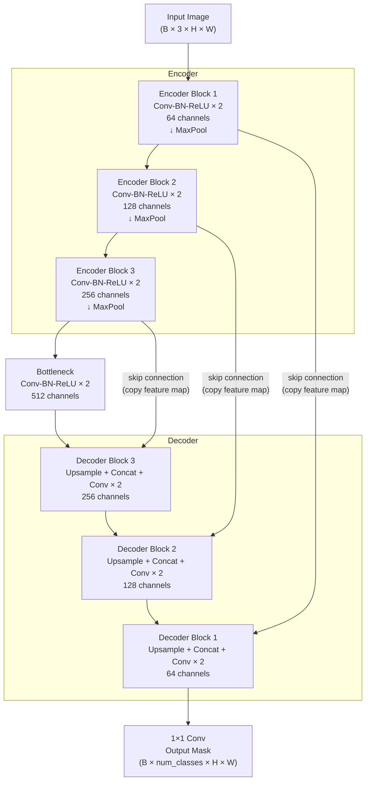

# Module 05 — Image Segmentation: From Pixels to Understanding

> **Track:** Computer Vision Lab  
> **Prerequisites:** Module 04 (CNNs & Classification), basic understanding of convolutional layers  
> **Duration:** ~4 hours (notebook) + reading

---

## Table of Contents

1. [The CV Task Taxonomy](#1-the-cv-task-taxonomy)
2. [Why CNNs Can't Do Segmentation Directly](#2-why-classification-cnns-cant-do-segmentation-directly)
3. [Fully Convolutional Networks (FCN)](#3-fully-convolutional-networks-fcn)
4. [U-Net: The Encoder-Decoder with Skip Connections](#4-u-net-the-encoder-decoder-with-skip-connections)
5. [Loss Functions for Segmentation](#5-loss-functions-for-segmentation)
6. [Class Imbalance: The Silent Killer](#6-class-imbalance-the-silent-killer)
7. [Feynman Checkpoint](#7-feynman-checkpoint)

---

## 1. The CV Task Taxonomy

Computer Vision has a hierarchy of tasks, each demanding progressively more spatial understanding from the model:

```
┌─────────────────────────────────────────────────────────────────────────┐
│                      COMPUTER VISION TASK TAXONOMY                      │
└─────────────────────────────────────────────────────────────────────────┘

CLASSIFICATION                  DETECTION
──────────────                  ─────────
┌────────────┐                  ┌────────────┐
│            │                  │ ┌──────┐   │
│            │   ──────────►    │ │ cat  │   │
│    (cat)   │   "cat"          │ └──────┘   │
│            │                  │       ┌──┐ │
│            │                  │       │🐕│ │  "cat @ (x1,y1,x2,y2)"
└────────────┘                  └────┬──┘──┘─┘  "dog @ (x3,y3,x4,y4)"
Output: 1 label                      └── boxes + labels


SEMANTIC SEGMENTATION           INSTANCE SEGMENTATION
─────────────────────           ─────────────────────
┌────────────┐                  ┌────────────┐
│░░░░░░░░░░░░│                  │▓▓▓▓▓░░░░░░░│
│░░░CAT░░░░░│   all cats are   │▓▓cat_1▓░░░│   cat_1 = instance 1
│░░░░░░░░░░░░│   class "cat"   │▓▓▓▓▓░░░░░░░│   cat_2 = instance 2
│░░░░░░░░░░░░│                  │░░░░░░▒▒▒▒▒░│   (different pixels)
│░░░░░░░░░░░░│                  │░░░░░░▒cat_2│
└────────────┘                  └────────────┘
Output: pixel class map         Output: pixel instance map
  (can't tell apart two cats)     (uniquely identifies each object)


PANOPTIC SEGMENTATION
─────────────────────
Combines both:
  • "stuff" classes (sky, grass, road) → semantic labels
  • "things" classes (cars, people, cats) → instance labels

Output: every pixel gets (class_label, instance_id)
```

### Quick Reference Table

| Task | Output | Granularity | Can tell 2 cats apart? |
|------|--------|-------------|------------------------|
| Classification | 1 label | Image-level | ✗ |
| Detection | Boxes + labels | Object-level | ✗ (separate boxes) |
| Semantic Segmentation | Per-pixel class | Pixel-level | ✗ |
| Instance Segmentation | Per-pixel instance | Pixel-level | ✓ |
| Panoptic Segmentation | Per-pixel (class + id) | Pixel-level | ✓ |

---

## 2. Why Classification CNNs Can't Do Segmentation Directly

### The Architecture Problem

A standard classification CNN looks like this:

```
Input Image (224×224×3)
        │
   [Conv Block 1]  → 112×112×64
        │
   [Conv Block 2]  → 56×56×128
        │
   [Conv Block 3]  → 28×28×256
        │
   [Conv Block 4]  → 14×14×512
        │
   [Conv Block 5]  → 7×7×512
        │
 [Global Avg Pool] → 1×1×512  ◄──── SPATIAL INFORMATION DESTROYED HERE
        │
   [FC Layer]      → 1000 class scores
        │
     "cat"
```

**The core problem:** After `Global Average Pooling`, the spatial structure of the feature maps is collapsed into a single vector. We know *what* is in the image, but we've forgotten *where*.

### The Spatial Information Loss

Consider a 4×4 feature map representing detections of "cat ears":

```
Before pooling (knows where ears are):    After global avg pool:
┌───┬───┬───┬───┐                        ┌──────┐
│ 0 │ 0 │ 0 │ 0 │                        │      │
├───┼───┼───┼───┤   ─────────────────►   │ 0.25 │  just a number!
│ 0 │ 1 │ 1 │ 0 │                        │      │
├───┼───┼───┼───┤                        └──────┘
│ 0 │ 0 │ 0 │ 0 │
├───┼───┼───┼───┤
│ 0 │ 0 │ 0 │ 0 │
└───┴───┴───┴───┘
The 1s were at position (1,1) and (1,2)   We know "some ears detected"
                                           but we can't say WHERE.
```

To do segmentation, we need an output of the **same spatial resolution** as the input — one prediction per pixel. Global pooling makes this impossible.

---

## 3. Fully Convolutional Networks (FCN)

### The Key Insight

FCN (Long et al., 2015) makes a simple but powerful realization:

> **Fully connected layers are just convolutions with 1×1 kernels.**

If a fully connected layer maps `[N×N×C → K]`, we can replace it with a convolution of kernel size `N×N` and `K` output channels, and it will produce `[1×1×K]`. The same transformation, but now it's a convolution that can process any spatial size.

### FCN Architecture

```
Input (H×W×3)
     │
[Encoder / Backbone]
     │
  Feature maps (H/32 × W/32 × C)   ← small spatial resolution, rich semantics
     │
[1×1 Conv]  ← replaces FC layers, now it's "convolutional"
     │
[Upsampling / Transposed Conv]
     │
Output (H×W×num_classes)   ← full resolution prediction map!
```

### Upsampling Methods

| Method | How | Learned? | Quality |
|--------|-----|----------|---------|
| Bilinear Interpolation | Fixed math | ✗ | Blurry edges |
| Transposed Convolution | Learnable filter | ✓ | Can learn sharp edges |
| Pixel Shuffle | Rearranges channels into spatial | ✓ | Efficient |

### The Problem with Vanilla FCN

When you downsample aggressively (32× in VGG), the fine spatial details are lost. Even if you upsample back, you're working from a very coarse feature map. The result: **blurry segmentation boundaries**.

**Solution:** U-Net.

---

## 4. U-Net: The Encoder-Decoder with Skip Connections

### The Architecture (ASCII Diagram)

```
U-Net Architecture
══════════════════════════════════════════════════════════════════════

 Input                                                      Output
(572×572)                                                 (388×388)
    │                                                          ▲
    ▼                                                          │
┌─────────┐                                              ┌─────────┐
│ Conv×2  │──────────────────────────────────────────────│ Conv×2  │
│ 64 ch   │                                              │ 64 ch   │
└────┬────┘                                              └────┬────┘
     │ MaxPool 2×                         Upsample 2× + concat│
     ▼                                              ▼         │
┌─────────┐                                    ┌─────────┐   │
│ Conv×2  │────────────────────────────────────│ Conv×2  │   │
│ 128 ch  │         SKIP CONNECTIONS           │ 128 ch  │   │
└────┬────┘         (copy & crop)              └────┬────┘   │
     │ MaxPool 2×                         Upsample 2×│       │
     ▼                                         ▼    │        │
┌─────────┐                              ┌─────────┐│        │
│ Conv×2  │──────────────────────────────│ Conv×2  ││        │
│ 256 ch  │                              │ 256 ch  ││        │
└────┬────┘                              └────┬────┘│        │
     │ MaxPool 2×               Upsample 2×   │     │        │
     ▼                                   ▼    │     │        │
┌─────────┐                         ┌─────────┐    │        │
│ Conv×2  │─────────────────────────│ Conv×2  │    │        │
│ 512 ch  │                         │ 512 ch  │    │        │
└────┬────┘                         └────┬────┘    │        │
     │ MaxPool 2×         Upsample 2×    │          │        │
     ▼                          ▼        │          │        │
┌─────────────────────────────────┐      │          │        │
│         BOTTLENECK              │──────┘          │        │
│         Conv×2 / 1024 ch        │                 │        │
└─────────────────────────────────┘                 │        │
                                                    │        │
◄──────────── ENCODER ──────────────────────────────► ◄── DECODER ──►
```

### The U-Shape Explained

```
Channel size:      64   128   256   512   1024   512   256   128   64
Spatial size:  full  half  qtr  8th   16th   8th   qtr  half  full

                     ┌─────────────────┐
              ┌──────┘                 └──────┐
          ┌───┘                               └───┐
      ┌───┘                                       └───┐
  ────┘      ENCODER (downsampling)  BOTTLENECK        └──── DECODER (upsampling)
             shrinks spatial size               restores spatial size
             expands channel depth              compresses channel depth
```

### Skip Connections: The Key Innovation

Without skip connections, the decoder has to reconstruct precise spatial details from the bottleneck alone — a highly compressed representation. Fine structures (thin blood vessels, cell boundaries) are impossible to recover.

```
Without skip connections:
  Encoder [detailed edges at 256×256] → compressed bottleneck → Decoder
  "I know there's a cell, but where exactly is the membrane?"

With skip connections:
  Encoder [detailed edges at 256×256] ──────────────────────────────────────┐
                                                                             ▼
  Encoder → compressed bottleneck → Decoder [upsample to 256×256] → Concat(encoder_feat, decoder_feat)
  "I know the semantic context FROM the bottleneck PLUS the exact edge location FROM the encoder!"
```

**What skip connections preserve:**
- High-frequency spatial details (edges, corners, textures)
- Low-level features at their original resolution
- Gradient flow to early encoder layers (helps training stability)

**What would be lost without them:**
- Precise localization of thin structures
- Sharp segmentation boundaries
- Fine details that were discarded during downsampling

### Mermaid Flowchart: U-Net Encoder-Decoder



---

## 5. Loss Functions for Segmentation

### 5.1 Binary Cross-Entropy (BCE)

For binary segmentation (foreground vs. background):

```
BCE(y, ŷ) = -[y·log(ŷ) + (1-y)·log(1-ŷ)]
```

- Treats every pixel **independently**
- Works well when classes are **balanced**
- **Problem:** On imbalanced data (99% background), loss is dominated by easy-to-classify background pixels

### 5.2 Dice Loss

```
Dice Loss = 1 - Dice Score

                2 × |Prediction ∩ Ground Truth|
Dice Score = ─────────────────────────────────────
               |Prediction| + |Ground Truth|

           = 1 - [  2 × Σ(p_i × g_i) + ε  ]
                    [Σp_i + Σg_i + ε]
```

- `ε` (epsilon) is a smoothing term to avoid division by zero
- **Directly optimizes the metric we care about** (Dice coefficient = 2×IoU/(1+IoU) approximately)
- **Class-imbalance robust:** The denominator is normalized by the total predicted/true pixels, so rare foreground is not dominated by the large background mass
- Most commonly used in medical imaging segmentation

### 5.3 Combined BCE + Dice Loss

```
L_combined = α·BCE + (1-α)·Dice_Loss
```

Typically `α = 0.5`. This combination:
- BCE provides stable gradients everywhere
- Dice loss provides imbalance robustness
- Together they train faster and more reliably than either alone

### 5.4 Focal Loss

```
FL(p_t) = -α_t · (1 - p_t)^γ · log(p_t)
```

- `(1 - p_t)^γ` is the **modulating factor** — down-weights well-classified examples
- Easy backgrounds (p_t → 1) get nearly zero weight
- Hard examples (p_t → 0) get full weight
- Originally from RetinaNet for object detection, also useful in segmentation

### Loss Comparison Visualization

```
Loss Landscape on Imbalanced Data (5% foreground)
════════════════════════════════════════════════════════════════════════

Scenario: 1000 pixels, 50 foreground, 950 background

Model predicts ALL BACKGROUND (ŷ = 0 everywhere):

  BCE Loss:
  ┌────────────────────────────────────────────────┐
  │ Background contribution: 950 × log(1) = 0      │  ← trivially zero!
  │ Foreground contribution: 50 × log(0) = BIG     │  ← only 5% of pixels
  │                                                 │
  │ Total BCE ≈ small (background dominates)        │
  │ Gradient signal for foreground: WEAK            │
  └────────────────────────────────────────────────┘

  Dice Loss:
  ┌────────────────────────────────────────────────┐
  │ Intersection = 0 (predicted nothing)           │
  │ Dice = 2×0 / (0 + 50) = 0                     │
  │ Dice Loss = 1 - 0 = 1.0  (MAXIMUM LOSS)        │
  │                                                 │
  │ Gradient signal for foreground: STRONG          │
  └────────────────────────────────────────────────┘


Training Curve Comparison:
                                                          Dice (combined)
  1.0 │ ╲                                               ╲
      │  ╲  BCE                                          ╲
  0.8 │   ╲╲                                              ╲
      │    ╲╲__________                                    ╲
  0.6 │                ──────────────────────────────       ╲
      │                                               ──────  ╲
  0.4 │                                                     ╲   ╲
      │                                                      ╲   ──── converges
  0.2 │                                                       ╲
      │                                                        ──────────────
  0.0 │─────────────────────────────────────────────────────────────────────►
     Epoch  0        5        10       15       20       25       30

  ─── BCE-only model: Dice loss plateaus high (model learns all-background)
  ─── Combined model: Dice loss decreases (model learns foreground)
```

### Summary Table

| Loss | Handles Imbalance | Directly Optimizes IoU | Gradient Stability |
|------|:-:|:-:|:-:|
| BCE | ✗ | ✗ | ✓ High |
| Dice | ✓ | ✓ | ✗ Can be noisy |
| BCE + Dice | ✓ | Partially | ✓ Good |
| Focal | ✓ | ✗ | ✓ Good |

---

## 6. Class Imbalance: The Silent Killer

### The Medical Imaging Problem

```
Typical Medical Image: Tumor Segmentation

┌──────────────────────────────────────────────────────┐
│                                                      │
│  Background (healthy tissue)                        │
│                                                      │
│                                                      │
│                                                      │
│                         ████                         │
│                       ████████                       │
│                         ████     ← tumor: ~2%        │
│                           of all pixels              │
│                                                      │
│                                                      │
│                                                      │
└──────────────────────────────────────────────────────┘

Pixel Distribution:
  Background: 98% of pixels
  Tumor:       2% of pixels

If model predicts ALL background:
  Pixel Accuracy = 98%  ← sounds great!
  Dice Score     =  0%  ← completely useless
```

### Why Accuracy Is a Lie Here

The model that **never detects any tumor** gets **98% accuracy**. This is called the **accuracy paradox**.

```
Confusion Matrix for "Always Predict Background" model:

                    Predicted
                  BG      Tumor
Actual  BG      [9800]    [0]     ← 9800 correct (true negatives)
        Tumor   [ 200]    [0]     ← 200 wrong (false negatives)

Pixel Accuracy = (9800 + 0) / (9800 + 200) = 98% ← misleading!
Dice Score = 2×0 / (0 + 200) = 0 ← the truth
```

### The Right Metrics for Segmentation

Always report segmentation quality with **overlap-based metrics**:

| Metric | Formula | Range | Good value |
|--------|---------|-------|------------|
| **Dice Coefficient** | 2×\|A∩B\| / (\|A\|+\|B\|) | [0,1] | >0.8 |
| **IoU (Jaccard)** | \|A∩B\| / \|A∪B\| | [0,1] | >0.7 |
| **Precision** | TP / (TP + FP) | [0,1] | >0.85 |
| **Recall** | TP / (TP + FN) | [0,1] | >0.85 |
| **Pixel Accuracy** | (TP+TN) / Total | [0,1] | ⚠️ Can be misleading |

---

## 7. Feynman Checkpoint

> _"If you can't explain it simply, you don't understand it well enough."_ — Richard Feynman

Work through these questions before moving to the notebook. They test whether you've truly internalized the concepts, not just memorized the words.

---

### ❓ Question 1 — The Deceptive Metric

> **You trained a segmentation model on medical images where tumors occupy 3% of pixels. You used Cross-Entropy loss and got 97% pixel accuracy. Your doctor collaborator says the model is useless. Explain what went wrong and what loss function you should use instead.**

<details>
<summary>💡 Reveal Answer</summary>

**What went wrong:**

The model discovered the lazy shortcut — predict all-background for every pixel. With 97% background pixels, this trivially achieves 97% pixel accuracy without ever learning to identify a single tumor pixel.

Binary Cross-Entropy loss treats every pixel independently. The gradient update from 9700 background pixels vastly overwhelms the signal from 300 tumor pixels. The model correctly learns: "predicting background everywhere minimizes my loss."

**The telltale sign:** Check your Dice score. A model that never predicts the foreground class will have Dice = 0.0, no matter how high pixel accuracy is.

**The fix — use Dice Loss:**

```
Dice Loss = 1 - [2 × Σ(predicted × ground_truth) + ε] / [Σpredicted + Σground_truth + ε]
```

Dice loss is normalized by the total number of foreground pixels, not by the total pixels. When the model predicts all-background (predicted = 0 everywhere), the numerator is 0 and the denominator is just the ground truth mass → Dice Loss = 1.0 (maximum). The model receives a strong gradient to actually detect the tumor.

**Best practice:** Use combined `BCE + Dice loss`. BCE provides stable per-pixel gradients; Dice provides imbalance correction. Also switch your primary metric from accuracy to Dice score or IoU.

</details>

---

### ❓ Question 2 — Skip Connections Explained Simply

> **Explain U-Net skip connections to a software engineer. Why does copying feature maps from the encoder to the decoder help the model segment thin structures better? What information would be lost without them?**

<details>
<summary>💡 Reveal Answer</summary>

**The Software Analogy:**

Think of it like git branches with merge commits. The encoder progressively compresses the image (like zipping a file), building a rich semantic understanding ("this is a blood vessel") but losing spatial precision. By the time you reach the bottleneck, you know *what* is there but not *exactly where*.

The decoder unzips the semantic understanding back to full resolution. But unzipping a highly-compressed file doesn't perfectly recover the original — you lose edge sharpness.

Skip connections are like `git merge encoder_branch` at each resolution level. At every decoder stage, instead of unzipping from scratch, you **merge** the compressed semantic features with the original, high-resolution feature map from the corresponding encoder stage. Now you have both:

- **Context** (from the bottleneck path): "this pixel is probably blood vessel"
- **Spatial precision** (from the skip connection): "and the vessel boundary is exactly here"

**Why thin structures benefit most:**

A thin blood vessel (2–3 pixels wide) at 512×512 resolution disappears at 16×16 (compressed 32×). Even one pixel of misalignment in the upsampling is a catastrophic miss. The skip connection brings back the original 512×512 feature map showing the vessel edges at their true location.

**Without skip connections you lose:**
- High-frequency information (sharp edges, fine textures)
- Precise boundary localization
- Gradients to early encoder layers (training becomes harder)

**Result without skip connections:** The model segments general regions correctly, but boundaries are blurry and thin structures are missed or broken.

</details>

---

### ❓ Question 3 — Semantic vs. Instance Segmentation

> **Semantic segmentation vs Instance segmentation: explain the difference with a real-world use case where each would be the right choice. What information does instance segmentation have that semantic does not?**

<details>
<summary>💡 Reveal Answer</summary>

**The Core Difference:**

- **Semantic Segmentation:** Every pixel gets a *class label*. "All road is road. All sky is sky. All car is car." Two cars touching each other are indistinguishable — they're both just "car."

- **Instance Segmentation:** Every pixel gets a *class label AND an instance ID*. "This pixel belongs to car #1. That pixel belongs to car #2." Objects are individually identified even when touching.

**When to Use Semantic Segmentation:**
- **Autonomous driving — drivable surface detection.** You want to know "which pixels are road I can drive on?" You don't care that the road has multiple lanes, it's all just "drivable." Semantic is cheaper and sufficient.
- **Medical: Tissue type mapping.** "Which pixels are cancerous tissue, which are healthy?" There's one continuous region of interest, not individual instances.
- **Satellite: Land cover classification.** "Forest / water / urban / farmland" — areas, not individual instances.

**When to Use Instance Segmentation:**
- **Autonomous driving — pedestrian counting/tracking.** You need to know *how many* pedestrians are in the scene and *which pixels belong to each* to track them over time and avoid each one. Semantic gives you "pedestrian region" but can't distinguish 10 people standing close together.
- **Medical: Cell counting.** "How many individual cancer cells in this slide?" Semantic gives you "these are cancer cells" but merges touching cells. Instance segmentation separates cell #1 from cell #2.
- **Retail: Inventory counting.** "How many individual bottles/products on the shelf?" Instance is mandatory.

**Information instance segmentation has that semantic does not:**
1. **Count:** Exact number of object instances
2. **Individual identity:** Which pixels belong to the same object
3. **Trackability:** You can assign persistent IDs across video frames
4. **Occlusion handling:** When objects overlap, instance segmentation still tries to delineate each one

**The tradeoff:** Instance segmentation is significantly harder to train (requires panoptic or Mask R-CNN style architectures) and slower to run. Use semantic when counting/identification isn't needed.

</details>

---

## References & Further Reading

- **U-Net Paper:** Ronneberger et al., 2015 — [U-Net: Convolutional Networks for Biomedical Image Segmentation](https://arxiv.org/abs/1505.04597)
- **FCN Paper:** Long et al., 2015 — [Fully Convolutional Networks for Semantic Segmentation](https://arxiv.org/abs/1411.4038)
- **Dice Loss:** Milletari et al., 2016 — [V-Net: Fully Convolutional Neural Networks for Volumetric Medical Image Segmentation](https://arxiv.org/abs/1606.04797)
- **Focal Loss:** Lin et al., 2017 — [Focal Loss for Dense Object Detection](https://arxiv.org/abs/1708.02002)
- **DeepLab v3+:** Chen et al., 2018 — [Encoder-Decoder with Atrous Separable Convolution for Semantic Image Segmentation](https://arxiv.org/abs/1802.02611)
- **Mask R-CNN:** He et al., 2017 — [Mask R-CNN](https://arxiv.org/abs/1703.06870) (instance segmentation)

---

*Next: Open the notebook `05_segmentation.ipynb` to build, break, and truly understand U-Net segmentation.*
