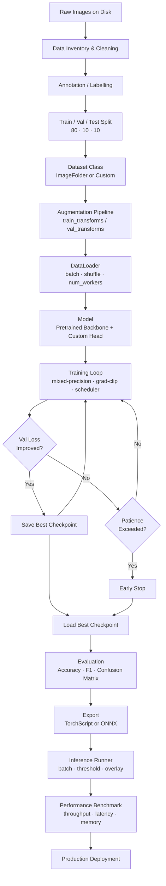

# Module 06 — Real Project: End-to-End Production CV Pipeline

> **Track:** Computer Vision Lab · **Module:** 06 of 06  
> **Kernel:** Python (Data AI .venv) · **Dataset:** CIFAR-10 (demo) / Custom directory dataset  
> **Framework:** PyTorch 2.x + torchvision + scikit-learn

---

## Overview

This module brings together every concept from Modules 01–05 into a **production-grade, end-to-end image classification pipeline**. You will:

1. Prepare and version a dataset from raw images on disk
2. Build an augmentation pipeline that generalizes learning
3. Train with modern best practices (mixed precision, gradient clipping, scheduling, early stopping)
4. Evaluate with the full suite of production metrics
5. Export a deployable artifact (TorchScript / ONNX)
6. Build an inference runner and benchmark it

---

## 1 — Full Production Pipeline Architecture



---

## 2 — Dataset Preparation

### 2.1 Directory Structure

The simplest convention PyTorch supports natively via `torchvision.datasets.ImageFolder`:

```
dataset/
├── train/
│   ├── cat/
│   │   ├── cat_001.jpg
│   │   └── cat_002.jpg
│   ├── dog/
│   └── bird/
├── val/
│   ├── cat/
│   ├── dog/
│   └── bird/
└── test/
    ├── cat/
    ├── dog/
    └── bird/
```

- **Class folder names become the label.** Keep them lowercase and slug-friendly.
- Each image should be unique across splits — never copy the same file into both train and val/test.
- Maintain aspect ratios when resizing; pad with black or replicate-border rather than squash.

### 2.2 Annotation Strategy

| Scenario | Tool | Output |
|---|---|---|
| Binary / multi-class folder sort | Manual rename + script | `ImageFolder`-compatible dirs |
| Bounding boxes (for crops) | [LabelImg](https://github.com/heartexlabs/labelImg) | YOLO `.txt` or Pascal VOC `.xml` |
| Semantic segmentation masks | [CVAT](https://cvat.ai/) | PNG masks |
| Weakly supervised (tags only) | Crowdsourcing sheet | CSV mapping `filename → class` |

For classification, you typically only need the **folder structure**. Annotation tooling becomes critical when labels must be refined from noisy web scrapes.

### 2.3 Train / Val / Test Split — 80 / 10 / 10

```python
import os, shutil, random
from pathlib import Path

def split_dataset(src_root: str, dst_root: str, seed: int = 42,
                  ratios=(0.8, 0.1, 0.1)):
    random.seed(seed)
    src = Path(src_root)
    dst = Path(dst_root)
    splits = ["train", "val", "test"]

    for cls_dir in sorted(src.iterdir()):
        if not cls_dir.is_dir():
            continue
        images = list(cls_dir.glob("*.[jp][pn]g"))
        random.shuffle(images)
        n = len(images)
        n_train = int(n * ratios[0])
        n_val   = int(n * ratios[1])
        boundaries = [0, n_train, n_train + n_val, n]

        for split, (lo, hi) in zip(splits, zip(boundaries, boundaries[1:])):
            out = dst / split / cls_dir.name
            out.mkdir(parents=True, exist_ok=True)
            for img in images[lo:hi]:
                shutil.copy(img, out / img.name)
```

> [!IMPORTANT]
> Always split **before** any augmentation or preprocessing. Augmenting first and then splitting is the #1 source of **data leakage** (identical augmented copies ending up in both train and val).

---

## 3 — Augmentation Pipeline

Augmentation artificially expands the diversity of training data, acting as a regularizer that discourages overfitting to exact pixel values.

### 3.1 `torchvision.transforms` — Full Train Pipeline

```python
from torchvision import transforms

train_transforms = transforms.Compose([
    transforms.RandomResizedCrop(224, scale=(0.8, 1.0)),
    transforms.RandomHorizontalFlip(p=0.5),
    transforms.ColorJitter(brightness=0.2, contrast=0.2,
                           saturation=0.1, hue=0.05),
    transforms.RandomRotation(degrees=15),
    transforms.ToTensor(),
    transforms.Normalize(mean=[0.485, 0.456, 0.406],
                         std=[0.229, 0.224, 0.225]),
])

val_transforms = transforms.Compose([
    transforms.Resize(256),
    transforms.CenterCrop(224),
    transforms.ToTensor(),
    transforms.Normalize(mean=[0.485, 0.456, 0.406],
                         std=[0.229, 0.224, 0.225]),
])
```

### 3.2 Why Each Augmentation Matters

| Transform | What it does | Why it helps |
|---|---|---|
| `RandomResizedCrop` | Randomly crops a patch and resizes it to the target size | Forces the model to recognise objects at different scales and positions; combats positional bias |
| `RandomHorizontalFlip` | Mirrors the image with probability `p` | Cats look the same facing left or right — this doubles effective dataset size for symmetric subjects; **do not use** for tasks where orientation is semantic (e.g., reading text, traffic signs) |
| `ColorJitter` | Randomly shifts brightness, contrast, saturation, and hue | Real-world lighting varies by time of day, camera sensor, weather; jitter makes features colour-agnostic |
| `RandomRotation` | Rotates by ±`degrees` | Handles cameras that aren't perfectly level; especially useful for aerial/drone imagery |
| `Normalize` | Subtracts mean, divides by std per channel | Re-centres activations into a range the pre-trained backbone expects (ImageNet statistics), speeds convergence, prevents gradient explosion |

> [!TIP]
> **Val/test transforms must NOT include random augmentations.** Use only deterministic `Resize` + `CenterCrop` + `ToTensor` + `Normalize`. Any randomness in the evaluation pipeline makes metrics non-reproducible.

### 3.3 Albumentations Concept (Alternative)

[Albumentations](https://albumentations.ai/) offers a richer library with hardware-accelerated transforms and pixel-level augmentations (elastic distortion, grid distortion, CLAHE) critical for medical imaging. The API mirrors torchvision but accepts numpy arrays:

```python
import albumentations as A
from albumentations.pytorch import ToTensorV2

train_aug = A.Compose([
    A.RandomResizedCrop(224, 224, scale=(0.8, 1.0)),
    A.HorizontalFlip(p=0.5),
    A.ColorJitter(brightness=0.2, contrast=0.2, saturation=0.1, hue=0.05),
    A.Rotate(limit=15),
    A.Normalize(mean=(0.485, 0.456, 0.406), std=(0.229, 0.224, 0.225)),
    ToTensorV2(),
])
```

---

## 4 — Training Best Practices

### 4.1 Mixed Precision (AMP)

Mixed precision trains using `float16` (or `bfloat16`) for forward/backward passes while keeping a `float32` master copy of weights. This:
- **Halves GPU memory** usage → larger batch sizes
- **2–3× throughput** on Tensor Core GPUs

```python
# Modern API — works on CUDA, MPS, and CPU
for images, labels in loader:
    optimizer.zero_grad()
    with torch.autocast(device_type=device.type, dtype=torch.float16):
        logits = model(images)
        loss   = criterion(logits, labels)

    scaler.scale(loss).backward()
    scaler.unscale_(optimizer)                         # needed before grad-clip
    torch.nn.utils.clip_grad_norm_(model.parameters(), max_norm=1.0)
    scaler.step(optimizer)
    scaler.update()
```

> [!NOTE]
> On **MPS (Apple Silicon)**, use `device_type='mps'`. On **CPU**, use `device_type='cpu'` — autocast will use `bfloat16` on supported CPUs. `GradScaler` is only useful for CUDA; skip it on MPS/CPU.

### 4.2 Gradient Clipping

Prevents **exploding gradients** (especially with large batches or deep networks). Clip the global L2 norm of all parameter gradients to `max_norm`:

```python
torch.nn.utils.clip_grad_norm_(model.parameters(), max_norm=1.0)
```

Call this **after** `loss.backward()` and **before** `optimizer.step()`.

### 4.3 Learning Rate Scheduling — CosineAnnealingLR

Cosine annealing gradually decays the LR from `η_max` to `η_min` following a cosine curve, then optionally restarts. This finds sharper minima than a fixed LR:

```python
scheduler = torch.optim.lr_scheduler.CosineAnnealingLR(
    optimizer, T_max=num_epochs, eta_min=1e-6
)
# Call at the END of each epoch (not each batch, unless using CosineAnnealingWarmRestarts)
scheduler.step()
```

The cosine shape means the LR drops **slowly at first** (exploiting the current minimum) then **quickly near the end** (settling into a sharp basin).

### 4.4 Early Stopping

Monitor validation loss (or accuracy). If it doesn't improve for `patience` consecutive epochs, abort training to save compute and avoid overfitting:

```python
class EarlyStopping:
    def __init__(self, patience=5, min_delta=1e-4):
        self.patience  = patience
        self.min_delta = min_delta
        self.counter   = 0
        self.best_loss = float('inf')

    def __call__(self, val_loss) -> bool:
        if val_loss < self.best_loss - self.min_delta:
            self.best_loss = val_loss
            self.counter   = 0
        else:
            self.counter += 1
        return self.counter >= self.patience
```

---

## 5 — Evaluation Metrics

### 5.1 Top-1 and Top-5 Accuracy

- **Top-1:** The highest-probability class is correct. Standard metric for ImageNet-scale benchmarks.
- **Top-5:** Any of the 5 highest-probability classes is correct. Useful when there are visually similar classes (e.g., 1000-class ImageNet).

```python
def topk_accuracy(output, target, k=5):
    with torch.no_grad():
        _, pred = output.topk(k, dim=1)          # (B, k)
        correct = pred.eq(target.view(-1, 1).expand_as(pred))
        return correct.any(dim=1).float().mean().item()
```

### 5.2 F1 Score — Macro vs Weighted

| Variant | How it averages | When to use |
|---|---|---|
| **Macro F1** | Simple mean across classes | When all classes are equally important regardless of size |
| **Weighted F1** | Weighted by class support | When class imbalance exists and you care about overall system performance |
| **Per-class F1** | Raw per-class score | Diagnosis, safety-critical: "can we detect disease X specifically?" |

```python
from sklearn.metrics import f1_score, classification_report
f1_macro    = f1_score(y_true, y_pred, average='macro')
f1_weighted = f1_score(y_true, y_pred, average='weighted')
report      = classification_report(y_true, y_pred, target_names=class_names)
```

### 5.3 Confusion Matrix

Reveals **which classes are confused with which** — far more actionable than a single accuracy number.

```python
from sklearn.metrics import confusion_matrix
import seaborn as sns, matplotlib.pyplot as plt

cm = confusion_matrix(y_true, y_pred)
sns.heatmap(cm, annot=True, fmt='d', xticklabels=class_names,
            yticklabels=class_names, cmap='Blues')
plt.ylabel('True'); plt.xlabel('Predicted')
plt.title('Confusion Matrix'); plt.show()
```

### 5.4 Per-Class Precision, Recall, F1

`classification_report` from scikit-learn gives you all three:

```
              precision    recall  f1-score   support
        cat       0.91      0.88      0.90      1000
        dog       0.85      0.87      0.86      1000
       bird       0.93      0.94      0.93      1000
```

> [!IMPORTANT]
> In **safety-critical applications** (medical diagnosis, fraud detection), **recall** (sensitivity) for the positive class is paramount. A model with 92% accuracy can have dangerously low recall for the minority positive class if the dataset is imbalanced.

---

## 6 — Model Optimization for Production

### 6.1 TorchScript — `torch.jit.script` vs `torch.jit.trace`

| Method | How | Pros | Cons |
|---|---|---|---|
| `torch.jit.trace` | Runs a sample input through the model, records operations | Works on any model without code changes | **Does not capture control flow** (if/else, loops based on data) — can silently produce wrong results for dynamic paths |
| `torch.jit.script` | Parses Python source and compiles to TorchScript IR | **Correctly handles control flow**, loops, conditionals | Model code must conform to TorchScript's subset of Python (no arbitrary Python) |

**When to use trace:** Pure feedforward models (ResNet, EfficientNet) with no data-dependent branching.  
**When to use script:** Transformers, RNNs, or any model with dynamic control flow.

```python
# Tracing (simpler, works for ResNet/EfficientNet)
model.eval()
example_input = torch.randn(1, 3, 224, 224)
scripted = torch.jit.trace(model, example_input)
scripted.save("classifier.pt")

# Loading
loaded = torch.jit.load("classifier.pt")
output = loaded(example_input)
```

### 6.2 ONNX Export

ONNX (Open Neural Network Exchange) creates an interoperable graph that can run on ONNX Runtime, TensorRT, CoreML, or on-device via ONNX Runtime Mobile:

```python
torch.onnx.export(
    model,
    example_input,
    "classifier.onnx",
    export_params=True,
    opset_version=17,
    input_names=["input"],
    output_names=["logits"],
    dynamic_axes={"input": {0: "batch_size"}, "logits": {0: "batch_size"}},
)
```

Validate the export:
```python
import onnxruntime as ort
sess = ort.InferenceSession("classifier.onnx")
out  = sess.run(["logits"], {"input": example_input.numpy()})
```

---

## 7 — Visual Inference Runner

```python
from PIL import Image
import torch, torchvision.transforms as T

def run_inference(image_path: str, model_path: str,
                  class_names: list[str], top_k: int = 3,
                  confidence_threshold: float = 0.1):
    """
    Load a TorchScript model, run inference, return top-k predictions.
    """
    model = torch.jit.load(model_path, map_location="cpu")
    model.eval()

    transform = T.Compose([
        T.Resize(256), T.CenterCrop(224), T.ToTensor(),
        T.Normalize([0.485, 0.456, 0.406], [0.229, 0.224, 0.225]),
    ])

    img   = Image.open(image_path).convert("RGB")
    inp   = transform(img).unsqueeze(0)           # (1, 3, 224, 224)

    with torch.no_grad():
        logits = model(inp)
        probs  = torch.softmax(logits, dim=1)[0]

    top_probs, top_ids = probs.topk(top_k)
    results = [
        (class_names[idx], prob.item())
        for idx, prob in zip(top_ids, top_probs)
        if prob.item() >= confidence_threshold
    ]
    return results
```

**Batch inference** — process multiple images in one forward pass for maximum GPU utilisation:

```python
def run_batch_inference(image_paths, model, transform, device, batch_size=32):
    all_preds = []
    for i in range(0, len(image_paths), batch_size):
        batch_paths = image_paths[i : i + batch_size]
        tensors = torch.stack([
            transform(Image.open(p).convert("RGB")) for p in batch_paths
        ]).to(device)
        with torch.no_grad():
            logits = model(tensors)
            preds  = logits.argmax(dim=1)
        all_preds.extend(preds.cpu().tolist())
    return all_preds
```

---

## 8 — Performance Monitoring

### 8.1 Throughput and Latency

```python
import time

def benchmark(model, device, input_size=(3, 224, 224),
              batch_size=32, n_runs=100, warmup=10):
    model.eval()
    dummy = torch.randn(batch_size, *input_size, device=device)

    # Warmup
    for _ in range(warmup):
        with torch.no_grad():
            _ = model(dummy)

    # Timed runs
    start = time.perf_counter()
    for _ in range(n_runs):
        with torch.no_grad():
            _ = model(dummy)
    elapsed = time.perf_counter() - start

    total_images  = n_runs * batch_size
    throughput    = total_images / elapsed           # images / sec
    latency_ms    = (elapsed / n_runs) * 1000       # ms per batch
    latency_per   = latency_ms / batch_size         # ms per image
    return {"throughput_img_s": throughput,
            "latency_batch_ms": latency_ms,
            "latency_per_img_ms": latency_per}
```

### 8.2 Memory Usage

```python
# GPU
print(f"Allocated: {torch.cuda.memory_allocated() / 1e6:.1f} MB")
print(f"Reserved:  {torch.cuda.memory_reserved()  / 1e6:.1f} MB")

# CPU / general process memory
import psutil, os
proc = psutil.Process(os.getpid())
print(f"RSS: {proc.memory_info().rss / 1e6:.1f} MB")
```

### 8.3 Key Production KPIs to Track

| Metric | Acceptable range (example) | Alert threshold |
|---|---|---|
| Throughput | ≥ 200 img/s (GPU) | < 100 img/s |
| Per-image latency | ≤ 5 ms (GPU) | > 20 ms |
| Peak GPU memory | < 2 GB | > 6 GB |
| Val accuracy drift (weekly) | ≤ 1% drop | > 3% drop |
| Confidence distribution shift | Baseline KS-stat < 0.05 | > 0.15 |

---

## 9 — Feynman Checkpoint Questions

> [!NOTE]
> These are **open-ended design questions** with no single correct answer. Practice by writing out your answer, then stress-testing it with a colleague or mentor.

---

### ❓ Checkpoint 1

**"Your production image classifier needs to run on a mobile device. Walk through all the choices you would make from architecture selection to model export format. What tradeoffs did you make?"**

Think about:
- Architecture: MobileNetV3, EfficientNet-Lite, SqueezeNet — how do you balance accuracy vs parameter count vs FLOPs?
- Quantization: Post-training quantization (INT8) vs quantization-aware training — what accuracy do you sacrifice?
- Export: TorchScript for PyTorch Mobile vs ONNX for ONNX Runtime Mobile vs CoreML (iOS) vs TFLite (Android) — which runtime is on the target device?
- Input resolution: Dropping from 224→96 saves 5× FLOPs but degrades fine-grained features — is your task tolerant of this?
- Latency budget: What is the acceptable response time for the UX? Does inference need to be on-device (privacy) or can you hit a server?

---

### ❓ Checkpoint 2

**"Your model has 92% overall accuracy but your boss says the medical diagnosis use case requires per-class recall > 95% for the positive class. Why is overall accuracy insufficient here? What metrics would you track and how would you modify training to optimize them?"**

Think about:
- Why accuracy fails on imbalanced datasets (a model that always predicts "negative" gets 95% accuracy when only 5% of cases are positive)
- Metrics to prioritize: **Sensitivity/Recall** (TP / (TP + FN)) for the positive class, **AUROC**, **PR-AUC**
- Training modifications: class-weighted `CrossEntropyLoss`, oversampling (SMOTE-style for images: oversample minority), focal loss (`FL(pt) = -(1-pt)^γ log(pt)`)
- Threshold tuning: don't use 0.5 as the decision boundary — tune it on val set to hit 95% recall, then report the precision at that threshold
- Regulatory context: in medical AI, you often want to minimise FN (missed diagnoses) even at the cost of FP (unnecessary follow-up tests)

---

### ❓ Checkpoint 3

**"Explain data leakage to a junior engineer joining your team. Give 3 specific examples of how it can accidentally happen in a CV project and how to prevent each one."**

**Data leakage** occurs when information from the test/val set "leaks" into training, making your evaluation metrics falsely optimistic. The model has effectively "seen the answers" — it won't generalise to truly unseen data.

| # | How it Happens | Prevention |
|---|---|---|
| 1 | **Augmenting before splitting:** You apply augmentations to the full dataset, then split. An augmented copy of a test image ends up in train. | Always split first on original files, then apply augmentations only to the train split. |
| 2 | **Normalisation statistics from the full dataset:** You compute `mean` and `std` of pixel values across all images (including test), then use those statistics everywhere. | Compute `mean` and `std` on the train set only. Use those same values for val and test transforms. |
| 3 | **Near-duplicate images across splits:** A dataset scraped from the web contains near-duplicate images (slightly cropped versions of the same photo). If duplicates land in both train and test, the model has essentially memorised test images. | Run a perceptual hash deduplication (`imagehash` library) before splitting. Remove near-duplicates or ensure they stay within the same split. |

---

## Prerequisites

Before starting this module, you should be comfortable with:
- Module 01: PyTorch tensors, autograd, basic training loop
- Module 02: CNNs, pooling, receptive fields
- Module 03: Transfer learning, fine-tuning, frozen vs unfrozen layers
- Module 04: Data loading, `DataLoader`, `Dataset`, custom transforms
- Module 05: Evaluation metrics, overfitting diagnosis

## Dependencies

```bash
pip install torch torchvision scikit-learn matplotlib seaborn Pillow psutil
# Optional for ONNX:
pip install onnx onnxruntime
# Optional for richer augmentations:
pip install albumentations
```

---

*End of Module 06 — You now have the full toolkit for production computer vision. Ship it.* 🚀
