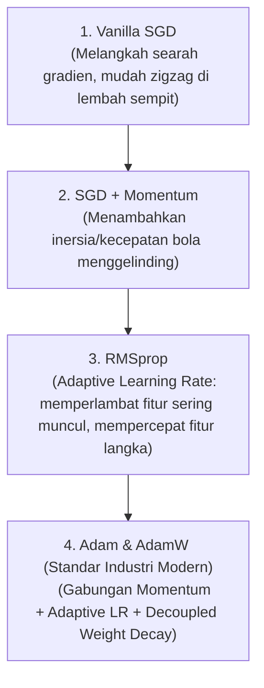

# ⚙️ Modul 02: The Learning Engine & Optimization

Selamat datang di Modul 02! Jika Modul 01 membahas *struktur fisik* (anatomi) jaringan saraf, modul ini membahas **mesin penggerak yang membuat jaringan saraf benar-benar bisa belajar dari kesalahan**: Loss Functions, Backpropagation, dan Optimizers.

---

## 🎯 Tujuan Pembelajaran
Setelah menyelesaikan modul ini, Anda akan:
1. Memahami bagaimana **Loss Function** mengukur kesalahan dan mengapa *Cross-Entropy Loss* adalah standar emas untuk klasifikasi probabilitas.
2. Memahami intuisi **Backpropagation & Chain Rule** (bagaimana sinyal eror merambat mundur dari output ke setiap parameter).
3. Memahami evolusi dan cara kerja algoritma optimasi: **SGD $\rightarrow$ Momentum $\rightarrow$ RMSprop $\rightarrow$ Adam & AdamW**.
4. Memahami peran **Learning Rate Schedules** (Warmup, StepLR, Cosine Annealing) dalam membantu model konvergen ke lembah loss global.
5. Melakukan **Sabotage Lab**: Mendiagnosis gejala Learning Rate yang meledak (*Loss NaN*) vs Learning Rate yang terlalu kecil (*Loss stagnant*).

---

## 🧠 Konsep & Mental Model

### 1. Loss Function: Kompas Penunjuk Arah
Model tidak tahu apakah ia pintar atau bodoh sampai **Loss Function** menghitung seberapa jauh tebakannya dari kenyataan.

```text
Input (X) ---> [ Model (W, b) ] ---> Prediksi (y_hat)
                                            |
Label Asli (y) --------------------> [ Loss Function L(y_hat, y) ] ---> Skalar Error (Loss)
```

#### A. Mean Squared Error (MSE) — Untuk Regresi
$$\text{MSE} = \frac{1}{N} \sum_{i=1}^{N} (y_i - \hat{y}_i)^2$$
* Menghitung kuadrat selisih antara nilai kontinu aktual dan prediksi.
* Memberikan penalti kuadratis untuk error besar.

#### B. Cross-Entropy Loss — Standar Klasifikasi
Mengapa kita tidak memakai MSE untuk memprediksi probabilitas kelas?
Karena MSE memberikan gradien yang sangat kecil (*plateau*) ketika probabilitas mendekati 0 atau 1, sehingga model belajar sangat lambat.

Sebaliknya, **Binary Cross-Entropy (BCE)** menggunakan fungsi logaritmik:
$$\text{BCE} = - \frac{1}{N} \sum_{i=1}^{N} \left[ y_i \log(\hat{y}_i) + (1 - y_i) \log(1 - \hat{y}_i) \right]$$

> 💡 **Mental Model IT**: Cross-Entropy adalah **"Sanksi Eksponensial untuk Kesombongan yang Salah"**.
> * Jika label asli $y=1$ dan model menebak $\hat{y} = 0.99$, $-\log(0.99) \approx 0.01$ (Loss hampir nol).
> * Jika label asli $y=1$ tapi model dengan percaya diri menebak $\hat{y} = 0.01$, $-\log(0.01) \approx 4.6$ (Penalti eror melonjak sangat tinggi!).

Di PyTorch: Gunakan `nn.BCEWithLogitsLoss` (binary) atau `nn.CrossEntropyLoss` (multiclass) karena mengintegrasikan Softmax dan Log-Loss secara numerik stabil (`log-sum-exp trick`) untuk menghindari *numerical underflow*.

---

### 2. Backpropagation: Aliran Balik Kesalahan via Chain Rule
Bagaimana satu bobot $w$ di layer pertama tahu berapa banyak ia harus berubah untuk memperbaiki eror di output?

Jawabannya adalah **Aturan Rantai Kalkulus (Chain Rule)**:
$$\frac{\partial \text{Loss}}{\partial w} = \frac{\partial \text{Loss}}{\partial \hat{y}} \cdot \frac{\partial \hat{y}}{\partial z} \cdot \frac{\partial z}{\partial w}$$

```text
Forward Pass   :  x ---> [ z = Wx + b ] ---> [ a = f(z) ] ---> Loss
                                                                  |
Backward Pass  :      <--- dL/dW <--- dL/dz <--- dL/da <-----------
```

* **dL/da**: Seberapa sensitif Loss terhadap output aktivasi.
* **da/dz**: Sensitivitas fungsi aktivasi terhadap input linear.
* **dz/dW**: Sensitivitas output linear terhadap bobot ($x$).

PyTorch menangani proses ini secara otomatis melalui **Autograd engine**: setiap operasi tensor mencatat riwayat komputasinya dalam Directed Acyclic Graph (DAG), dan ketika `loss.backward()` dipanggil, gradien dihitung mundur secara instan.

---

### 3. Evolusi Optimizer: Dari Kelereng Lambat ke Mesin Canggih

Setelah gradien $\nabla L$ dihitung, **Optimizer** bertugas memperbarui bobot:
$$W_{t+1} = W_t - \eta \cdot \nabla L$$
di mana $\eta$ adalah **Learning Rate** (ukuran langkah).



* **SGD (Stochastic Gradient Descent)**: Sederhana tapi rentan terjebak di *saddle points* dan berosilasi zigzag di lembah sempit.
* **Momentum**: Menambahkan "kecepatan/inersia" dari langkah sebelumnya ($v_t = \beta v_{t-1} + (1-\beta)\nabla L$). Bola menggelinding semakin cepat menuruni bukit.
* **Adam (Adaptive Moment Estimation)**: Menggabungkan Momentum (orde 1) dan variansi gradien (orde 2). Mengatur learning rate berbeda untuk setiap parameter secara otomatis.
* **AdamW**: Varian perbaikan Adam yang memisahkan *Weight Decay* (L2 Regularization) agar tidak terdistorsi oleh gradient variance. **Default pilihan utama di 95% project AI modern!**

---

### 4. Learning Rate Schedules: Seni Mengatur Kecepatan

Learning rate statis jarang optimal:
* Di awal training, kita butuh langkah agak besar untuk cepat keluar dari tebakan acak.
* Di akhir training, kita butuh langkah sangat kecil agar tidak melompati titik minimum global.

Skema paling populer:
1. **Cosine Annealing**: Menurunkan LR mengikuti kurva cosinus yang mulus hingga mendekati nol.
2. **Warmup**: Menaikkan LR secara bertahap di beberapa epoch awal untuk menstabilkan gradien sebelum mulai diturunkan.

---

## 🧪 Hands-on Lab

Silakan buka dan jalankan:
👉 **[`02_learning_engine.ipynb`](./02_learning_engine.ipynb)**

Alur hands-on:
1. **Loss Function Behavior**: Memplot perbedaan respons penalti MSE vs Cross-Entropy.
2. **Optimizer Race**: Mengadu SGD biasa, SGD+Momentum, dan Adam pada lembah elips yang curam (*elongated loss valley*) untuk melihat visualisasi zigzag vs mulus.
3. **The Sabotage Lab**:
   * *Kasus 1*: Learning rate terlalu besar ($lr = 5.0$) $\rightarrow$ Gradien meledak, loss menjadi `NaN` atau `Inf`.
   * *Kasus 2*: Learning rate terlalu kecil ($lr = 10^{-6}$) $\rightarrow$ Model beku, loss tidak berkurang setelah 100 epoch.
4. **Learning Rate Scheduler**: Menerapkan `torch.optim.lr_scheduler.CosineAnnealingLR` dan memantau kurva penurunannya.

---

## 🎯 Feynman Checkpoint (Uji Konsep)
1. *Mengapa Binary Cross-Entropy lebih unggul dibanding MSE dalam melatih model klasifikasi probabilitas?*
2. *Bagaimana konsep Momentum membantu optimizer melewati daerah lereng datar (plateau) atau saddle points?*
3. *Jika saat training Anda melihat output `Loss: nan` pada epoch ke-3, apa 2 kemungkinan penyebab utamanya dan bagaimana langkah pertama Anda memperbaikinya?*
