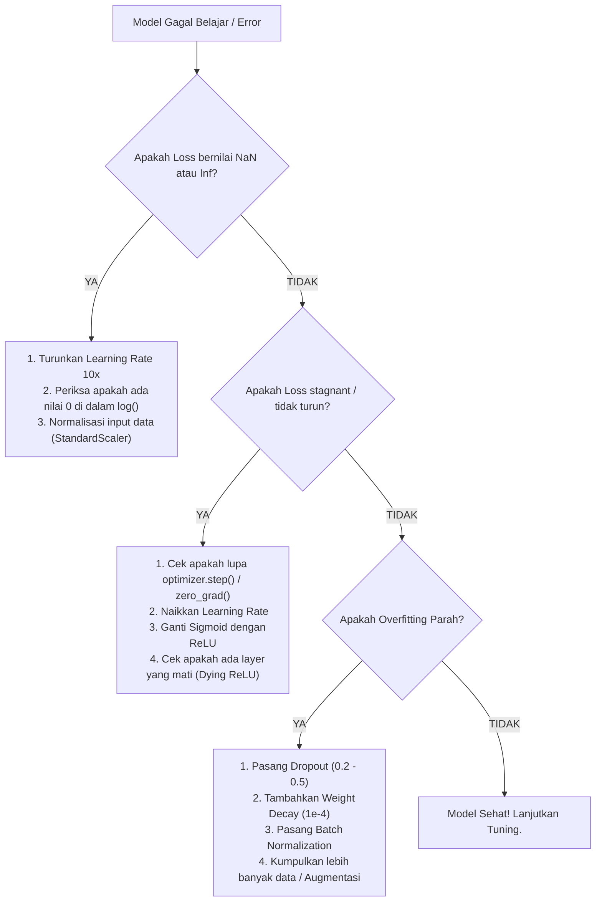

# 🛠️ Modul 03: Generalization, Tuning & Debugging

Selamat datang di Modul 03! Di dunia nyata, membangun arsitektur model hanya memakan waktu 20% dari pekerjaan. Sisa 80% waktu Anda dihabiskan untuk **mengejar generalisasi (mencegah overfitting)** dan **melakukan debugging ketika model menolak belajar**.

Modul ini adalah panduan bertahan hidup (*survival playbook*) seorang insinyur AI.

---

## 🎯 Tujuan Pembelajaran
Setelah menyelesaikan modul ini, Anda akan:
1. Memahami diagnosis **Overfitting vs Underfitting** melalui analisis grafik kurva *Train Loss vs Validation Loss*.
2. Memahami mekanisme pertahanan terhadap overfitting: **Dropout, Weight Decay (L2), dan Batch Normalization**.
3. Memahami **Weight Initialization**: Mengapa bobot tidak boleh di-set nol (*Symmetry Problem*) dan mengapa inisialisasi Kaiming/He sangat krusial.
4. Menguasai **The Neural Network Debugging Playbook**: Langkah sistematis saat menghadapi error `loss = NaN`, gradien hilang, atau akurasi mentok.
5. Menyelesaikan **Sabotage Lab: Break & Fix**: Mendiagnosis dan menyembuhkan model yang mengalami overfitting parah.

---

## 🧠 Konsep & Mental Model

### 1. Diagnosis Kurva Training: Overfitting vs Underfitting

```text
       LOSS                                           LOSS
        ^                                              ^
        |                                              |
        |  \    Validation Loss                        |   \   Validation Loss
        |   \     /---\---/                            |    \  ===========
        |    \---/                                     |     \
        |     \                                        |      \  Training Loss
        |      \  Training Loss                        |       \----------
        +------------------------> Epochs              +------------------------> Epochs
             [ OVERFITTING ]                                [ IDEAL CONVERGENCE ]
```

* **Underfitting (High Bias)**: Training loss dan validation loss keduanya tinggi. Model terlalu sederhana (kurang kapasitas) atau training belum cukup lama.
* **Overfitting (High Variance)**: Training loss terus turun mendekati nol, tetapi validation loss justru mulai naik tajam. Model tidak belajar pola umum, melainkan **menghafal noise** pada data training.

---

### 2. Regularization Toolkit: Mencegah Model "Menghafal"

#### A. Dropout (`nn.Dropout(p=0.3)`)
* **Mekanisme**: Di setiap langkah training forward pass, sejumlah $p\%$ neuron dimatikan secara acak (output diset ke nol).
* **Intuisi IT**: Seperti tim rekayasa software di mana anggota tim berganti-ganti cuti secara acak. Seluruh tim dipaksa memahami sistem secara menyeluruh dan tidak boleh ada satu orang yang menjadi "ketergantungan tunggal" (*co-adaptation*).
* **Catatan Penting**: Dropout hanya aktif saat training (`model.train()`). Saat pengujian (`model.eval()`), semua neuron kembali aktif dan bobotnya diskalakan secara otomatis oleh PyTorch.

#### B. Weight Decay / L2 Regularization (`weight_decay=1e-4`)
* **Mekanisme**: Menambahkan penalti kuadrat ukuran bobot ke fungsi loss:
  $$\text{Loss}_{\text{total}} = \text{Loss}_{\text{data}} + \frac{1}{2} \lambda \sum w_i^2$$
* **Intuisi**: Mencegah bobot menjadi terlalu besar dan ekstrem. Bobot yang kecil dan tersebar merata menghasilkan batas keputusan yang halus (*smooth*), bukan batas bergelombang tajam yang mengikuti noise.

#### C. Batch Normalization (`nn.BatchNorm1d`)
* **Mekanisme**: Menormalisasi output layer di dalam batch agar memiliki rata-rata $\mu = 0$ dan variansi $\sigma^2 = 1$, lalu melatih parameter skala ($\gamma$) dan geser ($\beta$).
* **Manfaat**: Menstabilkan distribusi aktivasi antar layer, mempercepat training 3–5x lipat, dan bertindak sebagai regularizer ringan.

---

### 3. Weight Initialization: Mengapa Tidak Boleh Di-set Nol?

> ⚠️ **The Symmetry Trap**: Jika semua bobot di-set ke nol ($W = 0$):
> 1. Semua neuron di layer tersembunyi menerima input linear yang sama ($z = 0$).
> 2. Semua neuron menghasilkan aktivasi yang sama persis.
> 3. Selama backpropagation, semua neuron menerima gradien yang sama persis.
> 4. **Akibatnya**: Berapa pun jumlah neuron yang Anda buat (misal 1000 neuron), seluruh neuron akan belajar fitur yang identik. Jaringan Anda hanya setara dengan 1 neuron tunggal!

**Standar Inisialisasi Modern**:
* **Xavier / Glorot Initialization**: Digunakan untuk layer dengan aktivasi simetris (Tanh, Sigmoid).
* **Kaiming / He Initialization**: Digunakan khusus untuk aktivasi **ReLU / LeakyReLU** agar variansi aktivasi tidak mengecil mendekati nol (*vanishing*) atau membesar ke tak hingga (*exploding*) di layer yang sangat dalam.
*(Kabar baik: PyTorch menerapkan Kaiming He secara default pada `nn.Linear`!)*

---

### 4. 📋 The Neural Network Debugging Playbook

Jika model Anda tidak mau belajar, ikuti diagram alur debugging berikut:



---

## 🧪 Hands-on Lab

Buka dan jalankan:
👉 **[`03_tuning_and_debugging.ipynb`](./03_tuning_and_debugging.ipynb)**

Alur hands-on:
1. **The Overfitting Sandbox**: Melatih model dengan kapasitas terlalu besar pada dataset kecil ber-noise dan memvisualisasikan overfit decision boundary yang bergelombang.
2. **Applying The Antidotes**: Menambahkan Dropout dan Weight Decay, lalu melihat validation loss kembali turun dan batas keputusan menjadi rapi.
3. **The Symmetry Sabotage**: Menginisialisasi bobot dengan angka nol dan melihat seluruh neuron terjebak memprediksi hal yang sama.
4. **The Break & Fix Challenge**: Memperbaiki model rusak yang sengaja kami siapkan (mengatasi kombinasi learning rate meledak dan data leakage).

---

## 🎯 Feynman Checkpoint (Uji Konsep)
1. *Mengapa kita wajib memanggil `model.eval()` sebelum melakukan evaluasi atau validasi pada data uji jika model kita memiliki layer `nn.Dropout`?*
2. *Jelaskan apa yang dimaksud dengan 'Symmetry Problem' jika seluruh bobot jaringan saraf diinisialisasi dengan angka nol.*
3. *Bagaimana Batch Normalization membantu mempercepat proses konvergensi training pada jaringan saraf yang dalam?*
