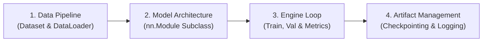

# 🏗️ Modul 04: The Production PyTorch Pipeline

Selamat datang di Modul 04! Anda telah menguasai anatomi jaringan (Modul 01), mesin pembelajarannya (Modul 02), dan teknik tuning serta debugging (Modul 03).

Sekarang saatnya bertransformasi menjadi **Software Engineer AI**: belajar menyusun kode PyTorch yang rapi, terstruktur, reusable, dan siap pakai untuk project skala industri.

---

## 🎯 Tujuan Pembelajaran
Setelah menyelesaikan modul ini, Anda akan:
1. Memahami arsitektur standar PyTorch: pemisahan `Dataset`, `DataLoader`, `nn.Module`, dan `Training Engine`.
2. Mampu membuat **Custom Dataset** dengan subclassing `torch.utils.data.Dataset` (`__len__` dan `__getitem__`).
3. Memahami peran **`DataLoader`**: Batching, shuffling, multiprocessing (`num_workers`), dan efisiensi memori.
4. Menulis **Modular Training & Validation Loop** lengkap dengan:
   * Tracking metrik Loss & Accuracy.
   * **Model Checkpointing** (`torch.save(model.state_dict(), ...)`).
   * **Early Stopping**: Menghentikan training otomatis sebelum overfit.
5. Menyelesaikan **Real Project**: Pipeline Prediksi Customer Churn / Risiko Kredit End-to-End.

---

## 🧠 Konsep & Mental Model

### 1. Arsitektur Pipeline Standar Industri

Kode AI profesional tidak pernah ditulis dalam satu cell Jupyter notebook raksasa 500 baris. Arsitektur produksi selalu memisahkan 4 tanggung jawab utama:



#### A. Data Pipeline: `Dataset` vs `DataLoader`
* **`Dataset`**: Bertanggung jawab atas *apa datanya dan bagaimana mengambil 1 sampel* index ke-$i$.
  ```python
  class CustomDataset(Dataset):
      def __len__(self): return len(self.data)
      def __getitem__(self, idx): return self.data[idx], self.labels[idx]
  ```
* **`DataLoader`**: Bertanggung jawab atas *orkestrasi batching, shuffling, dan loading paralel* dari storage ke RAM/VRAM:
  ```python
  loader = DataLoader(dataset, batch_size=32, shuffle=True)
  ```

#### B. Model Architecture: `nn.Module`
Selalu simpan parameter di dalam constructor `__init__`, dan definisikan alur komputasi di `forward(self, x)`:
```python
class ChurnClassifier(nn.Module):
    def __init__(self, in_features, hidden_dim):
        super().__init__()
        self.fc1 = nn.Linear(in_features, hidden_dim)
        self.relu = nn.ReLU()
        self.fc2 = nn.Linear(hidden_dim, 1)

    def forward(self, x):
        return self.fc2(self.relu(self.fc1(x)))
```

#### C. State Dict vs Full Model: Bagaimana Menyimpan Model?
> 💡 **Best Practice**: Jangan pernah menyimpan objek Python model langsung (`torch.save(model, 'model.pt')`). 
> **Selalu simpan State Dictionary** (`state_dict`):
> ```python
> # 1. Simpan hanya bobot dan bias (ringan & portabel):
> torch.save(model.state_dict(), "best_model.pt")
>
> # 2. Cara me-load kembali:
> model = ChurnClassifier(in_features, hidden_dim)
> model.load_state_dict(torch.load("best_model.pt"))
> model.eval()
> ```

---

### 2. Early Stopping: Mencegah Pemborosan Waktu Komputasi

Jika model sudah mencapai akurasi tertinggi di epoch 30, melanjutkan training hingga epoch 100 hanya akan menyebabkan overfitting dan membuang daya listrik.

**Logika Early Stopping**:
1. Pantau `val_loss` di setiap epoch.
2. Jika `val_loss` mencetak rekor terendah baru, simpan bobot model (`save_checkpoint`).
3. Jika selama `patience` epoch berturut-turut (misal 5 epoch) `val_loss` tidak membaik, hentikan loop training!

---

## 🧪 Hands-on Lab & Real Project

Buka dan jalankan:
👉 **[`04_pytorch_workflow.ipynb`](./04_pytorch_workflow.ipynb)**

Alur hands-on:
1. **Building Custom Dataset**: Membaca data tabular dan mengemasnya ke dalam PyTorch `Dataset` dan `DataLoader`.
2. **Modular Training Engine**: Membuat fungsi reusable `train_one_epoch()` dan `evaluate()`.
3. **Early Stopping & Checkpoint Implementation**: Menyematkan mekanisme auto-save bobot terbaik ke disk.
4. **End-to-End Real Project**: Melatih model klasifikasi risiko kredit / customer churn tabular, mengevaluasi Confusion Matrix dan ROC-AUC, lalu me-load kembali checkpoint untuk inferensi data baru!

---

## 🎯 Feynman Checkpoint (Uji Konsep)
1. *Apa perbedaan peran antara `torch.utils.data.Dataset` dan `torch.utils.data.DataLoader`?*
2. *Mengapa industri merekomendasikan menyimpan `model.state_dict()` daripada menyimpan objek `model` secara utuh?*
3. *Bagaimana parameter `pin_memory=True` dan `num_workers=4` pada DataLoader meningkatkan kecepatan training di GPU?*
