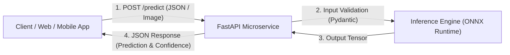

# 🚀 Modul 08: Model Serving & Production API Microservice

Selamat datang di Modul 08! Ini adalah modul puncak di mana keahlian **Teknologi Informasi** Anda bersinar secara penuh: **membawa model Deep Learning keluar dari Jupyter Notebook menuju server production berkinerja tinggi**.

---

## 🎯 Tujuan Pembelajaran
Setelah menyelesaikan modul ini, Anda akan:
1. Memahami siklus hidup model di industri: Research $\rightarrow$ Serialization $\rightarrow$ Optimization $\rightarrow$ Serving.
2. Memahami mengapa dan bagaimana meng-export model PyTorch ke format **ONNX (Open Neural Network Exchange)**.
3. Memahami konsep **Model Quantization** (FP32 $\rightarrow$ INT8) untuk memangkas ukuran model dan mempercepat latency inferensi.
4. Membangun REST API AI berkecepatan tinggi menggunakan **FastAPI** dan **Pydantic** untuk validasi data input.
5. Menjalankan microservice server AI secara lokal dengan **Uvicorn** dan menguji interaksi via Swagger UI (`/docs`).

---

## 🧠 Konsep & Mental Model

### 1. The Production Gap: Mengapa Notebook Tidak Boleh Masuk Server?
Di tahap riset, Jupyter Notebook sangat fleksibel. Namun di server production yang melayani ribuan request per detik:
* Python PyTorch penuh dengan *overhead* memori dan compiler interpreter.
* Kita butuh format model yang **bebas dari dependensi bahasa Python** agar bisa dijalankan di server C++, Go, mobile app (iOS/Android), atau web browser.

**Solusinya: ONNX (Open Neural Network Exchange)**
ONNX adalah standar format terbuka yang merepresentasikan grafik komputasi neural network sebagai DAG teroptimasi.
* **Kecepatan**: ONNX Runtime mengompilasi grafik operasi, menggabungkan layer (*kernel fusion*), dan memangkas operasi redundan.
* **Portabilitas**: Model yang dilatih di PyTorch bisa dijalankan di runtime mana pun tanpa perlu menginstal PyTorch di server production!

```text
[ PyTorch Model (.pt) ] ---> torch.onnx.export() ---> [ Model ONNX (.onnx) ]
                                                            |
                                        +-------------------+-------------------+
                                        |                   |                   |
                                   [ Cloud API ]      [ Mobile App ]       [ Edge IoT ]
                                 (FastAPI Server)      (iOS/Android)       (Raspberry Pi)
```

---

### 2. Anatomi Production REST API dengan FastAPI
Arsitektur microservice AI modern:



Komponen standar industri:
* **Endpoint `/health`**: Memberi tahu load balancer (Kubernetes/AWS) apakah server masih sehat.
* **Endpoint `/predict`**: Menerima payload data, melakukan pra-pemrosesan di memori, menjalankan inferensi, dan mengembalikan hasil dalam hitungan milidetik.
* **Pydantic Schema**: Menolak request dengan format data salah sebelum menyentuh model (mencegah server crash).

---

## 🧪 Hands-on Lab & Real Project

Buka dan jalankan:
👉 **[`08_deployment_mlops.ipynb`](./08_deployment_mlops.ipynb)**

Alur hands-on:
1. **Export to ONNX**: Mengambil model klasifikasi PyTorch yang telah kita latih dan meng-export-nya menjadi file `model.onnx`.
2. **Speed Benchmark**: Mengukur latency perbandingan eksekusi PyTorch vs ONNX Runtime.
3. **The Microservice Build**: Membangun file server mandiri [**`app.py`**](./app.py) dengan FastAPI.
4. **Testing The Live API**: Menjalankan server dengan `uvicorn app:app --reload` dan melakukan pengujian request langsung menggunakan `curl` atau interactive browser docs!

---

## 🎯 Feynman Checkpoint (Uji Konsep)
1. *Mengapa format ONNX memungkinkan model AI yang dilatih di Mac/Linux dengan PyTorch dapat dijalankan di server Windows berbasis C++ tanpa menginstal PyTorch?*
2. *Apa manfaat utama menggunakan Pydantic BaseModel untuk memvalidasi input request pada REST API Deep Learning?*
3. *Jelaskan perbedaan antara Batch Inference (Offline) dan Real-Time Inference (Online), serta tantangan latensi pada masing-masing skenario!*
