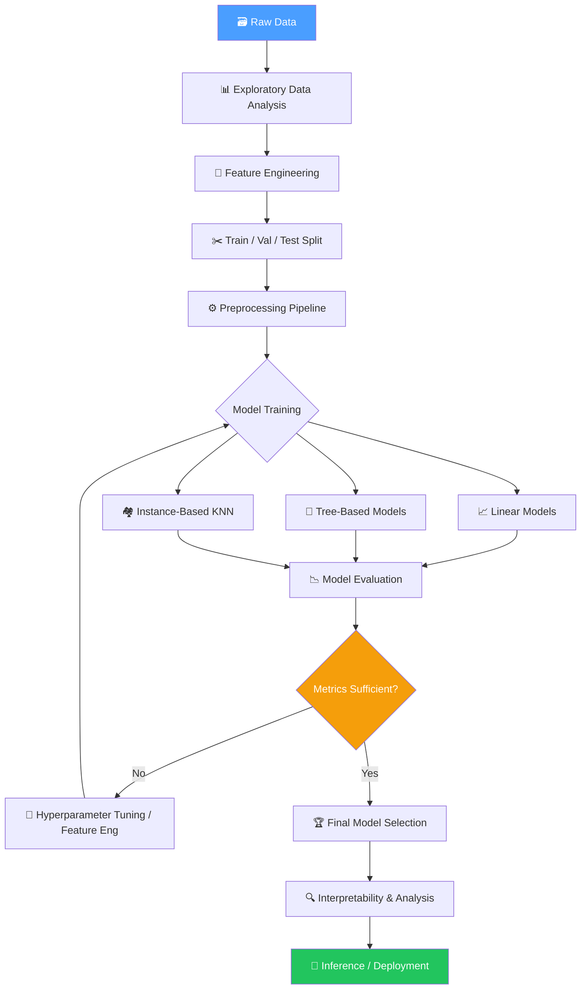
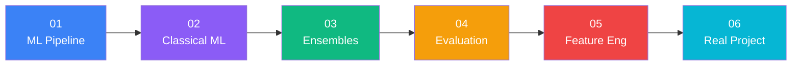

# 🤖 Machine Learning Track (Applied & Mental Model)

Track ini dirancang untuk menguasai Machine Learning secara mendalam melalui pendekatan **Inverted Engineering & Sabotage Lab** — belajar dari sistem yang bekerja, membedah internalnya, lalu sengaja merusaknya untuk memahami mengapa ia bekerja.

---

## 🎯 Metode Belajar: *Inverted Engineering & Sabotage Lab*

Setiap modul menggunakan pola 4 langkah terstruktur:

1. **The Working Blackbox** — Jalankan sistem end-to-end yang bekerja dalam 5 menit pertama. Tangkap gambaran utuh (*big picture*) sebelum masuk ke detail.
2. **Anatomical Dissection** — Bedah internal sistem: feature importance, data splits, parameter model, distribusi data, dan keputusan desain.
3. **The Sabotage Lab (Break & Fix)** — Sengaja rusak satu komponen (misal: data leakage, no scaling, wrong metric) dan amati gejalanya. Kemudian perbaiki dan pahami *mengapa* itu penting.
4. **The Clean Build + Feynman Test** — Bangun ulang solusi dengan kode production-clean dan jawab 3 pertanyaan Feynman untuk memvalidasi pemahaman konseptual.

---

## 🗺️ Roadmap Modul

| No | Modul | Fokus Materi | Deliverable / Hands-on |
|:---:|:---|:---|:---|
| **01** | [**ML System & Data Pipeline**](./modules/01_ml_workflow/README.md) | ML Pipeline, Train/Val/Test Split, Data Leakage, StandardScaler, sklearn Pipeline | Bangun pipeline end-to-end, temukan bug data leakage |
| **02** | [**Classical ML Algorithms**](./modules/02_classical_ml/README.md) | Linear/Logistic Regression, KNN, Naive Bayes, Bias-Variance Tradeoff, Decision Boundaries | Bandingkan 4 algoritma, visualisasi decision boundary |
| **03** | [**Tree-Based & Ensemble Methods**](./modules/03_ensemble_methods/README.md) | Decision Trees, Random Forest, Gradient Boosting, XGBoost, Feature Importance | Single Tree vs RF vs XGBoost, GridSearchCV tuning |
| **04** | [**Model Evaluation & Selection**](./modules/04_model_evaluation/README.md) | Confusion Matrix, Precision/Recall/F1, ROC-AUC, PR-AUC, Cross-Validation | Evaluasi fraud detection model, plot ROC curves |
| **05** | [**Feature Engineering & Selection**](./modules/05_feature_engineering/README.md) | Categorical Encoding, Numerical Transforms, Interaction Features, RFE | Kurangi fitur 50% tanpa kehilangan performa |
| **06** | [**Real Project: Credit Risk**](./modules/06_real_project/README.md) | End-to-End ML System, ColumnTransformer, Model Comparison, Inference Function | Production-ready Loan Default Prediction System |

---

## 🧠 Peta Konsep: Alur Machine Learning



---

## 📦 Struktur Direktori

```
machine-learning/
├── README.md                          ← Kamu ada di sini
├── shared/
│   └── plotters.py                    ← Utility: confusion matrix & ROC plotting
└── modules/
    ├── 01_ml_workflow/
    │   ├── README.md                  ← Konsep: Pipeline, Leakage, Splits
    │   └── 01_ml_workflow.ipynb       ← Notebook: Build ML Pipeline
    ├── 02_classical_ml/
    │   ├── README.md                  ← Konsep: Regression, KNN, Naive Bayes
    │   └── 02_classical_ml.ipynb      ← Notebook: Algorithm Comparison
    ├── 03_ensemble_methods/
    │   ├── README.md                  ← Konsep: Trees, RF, XGBoost
    │   └── 03_ensemble_methods.ipynb  ← Notebook: Ensemble Showdown
    ├── 04_model_evaluation/
    │   ├── README.md                  ← Konsep: Metrics, CV, Imbalanced Data
    │   └── 04_model_evaluation.ipynb  ← Notebook: Evaluation Deep Dive
    ├── 05_feature_engineering/
    │   ├── README.md                  ← Konsep: Encoding, Transforms, Selection
    │   └── 05_feature_engineering.ipynb ← Notebook: Feature Crafting
    └── 06_real_project/
        ├── README.md                  ← Konsep: End-to-End System Design
        └── 06_real_project.ipynb      ← Notebook: Credit Risk Production System
```

---

## 🛠️ Setup Environment

Semua notebook menggunakan virtual environment yang sudah tersedia:

```bash
# Kernel di Jupyter: "Python (Data AI .venv)"
# Lokasi venv: /Users/kharisaz/Playground/Data AI/.venv

# Verifikasi package yang tersedia:
# scikit-learn, pandas, numpy, matplotlib, seaborn, xgboost
```

---

## 📈 Learning Path yang Disarankan



Selesaikan modul secara berurutan — setiap modul membangun di atas konsep dari modul sebelumnya.

---

## 🏆 Cara Menggunakan Lab Ini

1. **Baca README modul** terlebih dahulu — pahami konsep sebelum menyentuh kode.
2. **Jalankan sel Working Blackbox** — lihat sistem bekerja end-to-end.
3. **Ikuti Anatomical Dissection** — inspect setiap komponen.
4. **Lakukan Sabotage Lab** — pecahkan sesuatu, amati symptom, perbaiki.
5. **Jawab Feynman Checkpoints** — jika kamu tidak bisa menjelaskan dengan kata-kata sendiri, kamu belum benar-benar mengerti.
6. **Kerjakan Challenge** — validasi pemahaman dengan kode mandiri.
